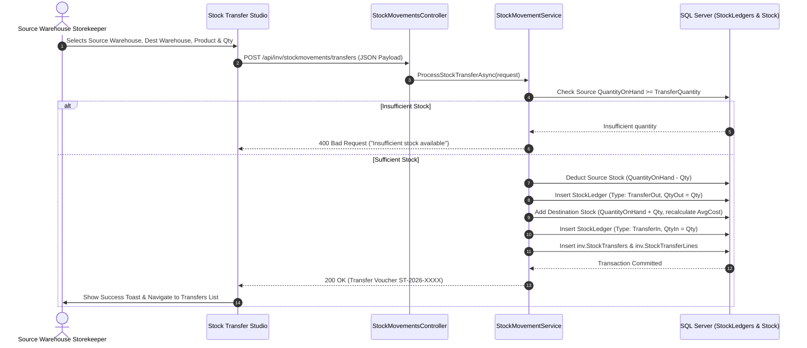

# Comprehensive Inventory Module Audit, International ERP Standards Gap Analysis, and Improvement Plan

**Project:** Enterprise Resource Planning (ERP) System  
**Module:** Inventory Control & Warehouse Logistics  
**Target Architecture:** ASP.NET Core 10 Web API, Entity Framework Core 10, Microsoft SQL Server 2025, Vanilla ES6+ SPA  
**Audit Date:** October 2026  
**Status:** Audit & Plan Completed — Awaiting User Approval (No Code/Database Modified)

---

## 1. Executive Summary & Objective

This document delivers a thorough functional, technical, and architectural audit of the **Inventory Management Module** across the ERP system. Every component—from database schemas and constraints to backend Web APIs, EF Core mapping, application services, client-side studios, and reporting routines—was inspected against established international ERP standards (such as **SAP S/4HANA Materials Management**, **Oracle Cloud SCM**, **UNSPSC / eCl@ss**, **GS1 Logistics**, and **IAS 2 Inventories**).

### High-Level Audit Verdict:
- **Database & Domain Foundations (Strong Baseline):** The database schema in the `inv` namespace possesses robust relational constraints, foreign keys, auditing columns (`SysGuid`, `RowVersion`, `CreatedAtUtc`, `CreatedBy`, `IsDeleted`), and a real-time transactional double-entry ledger (`inv.StockLedgers`). The multi-tenant segregation (`CompanyId`) and recent separation of physical depots (`inv.Depots`) from storage facilities (`inv.Warehouses`) provide an enterprise-grade structure.
- **Frontend–Backend Disconnection (Critical Gap):** While excellent backend services exist for atomic stock transfers, stock adjustments, and GL posting (`StockMovementService.cs`), portions of the frontend UI (`#studio-entry-stock-transfer` and `#studio-grn`) currently push mock objects directly into in-memory arrays (`ERP_STATE.stockTransfers`) or have partially hardcoded payload mappings, bypassing the transactional backend validation and GL voucher generation.
- **Missing Core Transactional Registries (Functional Gap):** Users can view the consolidated stock balance (`#studio-stock`), but there are no dedicated **List Registries** for **Stock Transfers**, **Stock Adjustments**, or **Goods Receipt Notes (GRN History)** with status tracking (Draft &rarr; Dispatched &rarr; Received &rarr; Reversed).
- **Valuation & Multi-UOM Depth (International Gap):** Although standard costing and moving average fields exist on the product master, conversion matrices between alternate packaging units (e.g., 1 Coil = 2.5 MT = 50 Sheets) and multi-step transfer authorization workflows (Dispatch &rarr; In-Transit &rarr; Receive) have not yet been bridged to frontend document entry.

---

## 2. Inventory Module Architecture & Component Inventory

### 2.1 Database Entities (`inv` Schema)

| Table | Business Purpose | Records | Key Columns & Constraints | Audit & Status |
| :--- | :--- | :--- | :--- | :--- |
| **`inv.Depots`** | Physical plants, factories, and commercial hubs | 3 | `CompanyId`, `DepotCode`, `DepotName`, `DepotType` | Active, soft-deletable, auditable |
| **`inv.Warehouses`** | Specific storage rooms/zones linked to depots | 4 | `DepotId` (FK), `WarehouseCode`, `WarehouseName`, `WarehouseType` | Active, soft-deletable, auditable |
| **`inv.UnitsOfMeasure`** | Base units of measure (PCS, KG, MT, BOX, etc.) | 6 | `UomCode`, `UomName`, `CompanyId` | Active, auditable |
| **`inv.ProductClasses`** | Category & GL Account Mapping (Inventory, COGS, Revenue) | 3 | `ClassCode`, `CategoryType`, `GlInventoryAccountId`, `GlCogsAccountId` | Fully linked to `gl.Accounts` |
| **`inv.Products`** | Master catalog items with weights, dimensions, HS code | 6 | `ProductCode`, `ProductName`, `ProductClassId`, `PrimaryUomId`, `NetWeight`, `HsCode` | Fully auditable, immutable code |
| **`inv.ProductStock`** | Real-time aggregated physical & allocated balance per warehouse | 6 | `WarehouseId` (FK), `ProductId` (FK), `QuantityOnHand`, `AllocatedQuantity`, `AverageCost` | Maintained by stock movements |
| **`inv.StockLedgers`** | Immutable transactional ledger of all posted movements | 13 | `WarehouseId`, `ProductId`, `TransactionDate`, `TransactionType`, `QuantityIn`, `QuantityOut`, `BalanceQuantity` | Immutable audit trail |
| **`inv.GoodsReceiptNotes`** | Inbound receiving documents against PO/Challan | 5 | `GrnNumber`, `WarehouseId`, `VendorId`, `Status`, `JournalVoucherId` | Linked to AP & GL |
| **`inv.GoodsReceiptNoteLines`** | Inbound line items with received quantities & batches | 6 | `GrnId` (FK), `ProductId` (FK), `QuantityReceived`, `UnitPrice`, `BatchNumber` | Detail lines |
| **`inv.StockAdjustments`** | Physical count gain/loss reconciliation vouchers | 1 | `AdjustmentNumber`, `WarehouseId`, `AdjustmentType`, `JournalVoucherId` (FK) | Integrated with General Ledger |
| **`inv.StockAdjustmentLines`** | Line-level gain/loss variance quantities & costs | 1 | `AdjustmentId` (FK), `ProductId` (FK), `AdjustmentQuantity`, `UnitCost` | Detail lines |
| **`inv.StockTransfers`** | Inter-warehouse inventory movement vouchers | 1 | `TransferNumber`, `FromWarehouseId`, `ToWarehouseId`, `Status` | Source/Dest Foreign Keys |
| **`inv.StockTransferLines`** | Transferred line items & quantities | 1 | `TransferId` (FK), `ProductId` (FK), `TransferQuantity`, `UnitCost` | Detail lines |

### 2.2 Backend Web APIs & Controllers

| Controller | Route | Implemented Endpoints | Backend Service Link |
| :--- | :--- | :--- | :--- |
| **`ProductsController`** | `/api/inv/products` | `GET /`, `GET /{id}`, `GET /code/{code}`, `POST /`, `PUT /{id}`, `DELETE /{id}`, `GET /depots`, `GET /warehouses`, `GET /classes`, `GET /uoms` | `IInventoryService` &rarr; `InventoryService.cs` |
| **`GoodsReceiptController`** | `/api/inv/goodsreceipt` | `GET /`, `GET /{id}`, `POST /`, `POST /{id}/receive`, `POST /{id}/cancel` | `IGoodsReceiptService` &rarr; `GoodsReceiptService.cs` |
| **`StockMovementsController`** | `/api/inv/stockmovements` | `GET /adjustments`, `GET /adjustments/{id}`, `POST /adjustments`, `GET /transfers`, `GET /transfers/{id}`, `POST /transfers` | `IStockMovementService` &rarr; `StockMovementService.cs` |
| **`InventoryReportsController`** | `/api/inv/reports` | `GET /stock-ledger?productId=X`, `GET /valuation?warehouseId=X` | `IInventoryReportingService` &rarr; `InventoryReportingService.cs` |

### 2.3 Frontend Studio Screens (`index.html`)

| Section ID | Screen Name | Current Type | Connectivity Status |
| :--- | :--- | :--- | :--- |
| `#studio-list-products` | Products Registry | List Registry | **Live:** Connected to `/api/inv/products` |
| `#studio-entry-product` | Product Specification | Entry Form | **Live:** Saves to `/api/inv/products`, validates, and redirects |
| `#studio-view-record` | Product Specification View | Read-Only Sheet | **Live:** Displays specification cards and generates printable A4 report |
| `#studio-list-depots` | Depots & Plants Registry | List Registry | **Live:** Reads from `/api/inv/products/depots` |
| `#studio-entry-depot` | Depot Setup Form | Entry Form | **Live:** Saves to `/api/inv/products/depots` |
| `#studio-list-warehouses` | Warehouses Registry | List Registry | **Live:** Reads from `/api/inv/products/warehouses` |
| `#studio-entry-warehouse` | Warehouse Setup Form | Entry Form | **Live:** Saves to `/api/inv/products/warehouses` |
| `#studio-stock` | Stock Balance Overview | Aggregate View | **Semi-Live:** Mix of static demo cards and live ledger data |
| `#studio-grn` | Goods Receipt Note Entry | Transaction Entry | **Partial:** Saves draft to `/api/inv/goodsreceipt`, but hardcodes fallback vendor/product IDs |
| `#studio-entry-stock-transfer` | Stock Transfer Entry | Transaction Entry | **Disconnected:** Pushes to local `ERP_STATE.stockTransfers` array without calling `/api/inv/stockmovements/transfers` |
| *Missing* | Stock Transfers Registry | List Registry | **Does Not Exist in UI** |
| *Missing* | Stock Adjustments Registry | List Registry | **Does Not Exist in UI** |
| *Missing* | GRN List Registry | List Registry | **Does Not Exist in UI** |

---

## 3. Comparison with International ERP Practices

```
                               INTERNATIONAL ERP INVENTORY MODEL (SAP / ORACLE / GS1)
┌───────────────────────────────────────────────────────────────────────────────────────────────────────┐
│ 1. ITEM MASTER & CLASSIFICATION (UNSPSC, GS1, ISO 80000)                                              │
│    • Product Code (SKU) • HS Tariff Code • Net/Gross Weight • Dimensions/CBM • Base/Purchase/Sales UOM │
├───────────────────────────────────────────────────────────────────────────────────────────────────────┤
│ 2. WAREHOUSE HIERARCHY (Physical Facility vs Storage Location)                                         │
│    • Depot / Plant (Parent) ──> Warehouses (RM, FG, WIP, Spares) ──> Bins / Racks / Bays               │
├───────────────────────────────────────────────────────────────────────────────────────────────────────┤
│ 3. TRANSACTIONAL CONTROL & MOVEMENT LIFECYCLE                                                         │
│    • Inbound (PO -> Pre-Receipt QC -> GRN -> Stock Ledger -> Accrued Clearing JV)                    │
│    • Inter-Warehouse Transfer (Request -> Dispatch [In-Transit] -> Receiving Confirmation)            │
│    • Stock Adjustment (Physical Count -> Variance Review -> Approval -> Stock Ledger + Gain/Loss JV)  │
├───────────────────────────────────────────────────────────────────────────────────────────────────────┤
│ 4. INVENTORY VALUATION & AUDITING (IAS 2 Inventories)                                                 │
│    • Perpetual Weighted Moving Average Cost • Automated Double-Entry GL Integration                   │
│    • Stock Availability Matrix: On-Hand = (Available + Reserved + In-Transit)                         │
└───────────────────────────────────────────────────────────────────────────────────────────────────────┘
```

### Detailed Pillar Analysis:

| International ERP Practice | Industry Standard | Current ERP State | Gap / Compliance Verdict |
| :--- | :--- | :--- | :--- |
| **Item Classification** | UNSPSC & WCO HS Tariff Code | `HsCode`, `CategoryType`, and `ProductClass` implemented | **Compliant** |
| **Physical Logistics Data** | ISO 80000 Weights & Dimensions | Net/Gross Weight, Dimensions (L×W×H), CBM volume supported | **Compliant** |
| **Multi-UOM & Conversion** | UNECE Rec. 20 (Base vs Purchase vs Sales) | Single `PrimaryUomId` stored per product; PackSize is text | **Gap:** No mathematical conversion factor table (e.g. 1 Box = 24 PCS) |
| **Warehouse Structure** | Facility vs Storage Room | `inv.Depots` (Parent) &rarr; `inv.Warehouses` (Child) separated | **Compliant** |
| **Storage Bin / Rack** | Warehouse Sub-locations | Bin stored as text note on form | **Acceptable for Phase 1** (Bin master table can follow) |
| **Transfer Lifecycle** | 2-Step In-Transit Clearing | Backend performs 1-step direct debit/credit; Frontend is disconnected | **Major Gap:** Needs frontend API connection and in-transit tracking |
| **Stock Adjustments** | Physical Count Reconciliation | Full backend with auto-GL posting; UI entry form missing | **Major Gap:** No UI screen to execute or view adjustments |
| **Valuation Compliance** | IAS 2 Perpetual Weighted Average | Real-time moving average updated in `StockLedgers` & `ProductStock` | **Compliant** |
| **Negative Stock Control** | Strict Enterprise Constraint | Backend enforces `QuantityOnHand >= 0`; throws `InvalidOperationException` | **Compliant & Secure** |
| **Quality Control (QC)** | Pre-Receipt Quarantine | Flag on product master; GRN workflow records batch number | **Recommended:** Inbound Quarantine status before final stock ledger posting |

---

## 4. Categorized Findings & Deficiencies

### Category 1: Missing Components (Required for Full Functional Operations)

1. **Stock Transfers List Registry (`#studio-list-transfers`)**:
   - *Problem:* Users cannot view past stock transfers, their status (Pending, Dispatched, Received), source/destination warehouses, or date stamps.
   - *Requirement:* Standard List-first registry with search, warehouse filters, date range, and "+ New Transfer" action button.
2. **Stock Adjustments List & Entry Studio (`#studio-list-adjustments` / `#studio-entry-adjustment`)**:
   - *Problem:* Backend has a complete, working `ProcessStockAdjustmentAsync` with automated General Ledger voucher posting, but there is no screen in the UI for storekeepers or accountants to perform physical inventory count adjustments.
   - *Requirement:* Add adjustment registry and entry form supporting Stock Gain (+), Stock Loss (-), Damaged Scrap, and Expiry write-offs.
3. **Goods Receipt Notes (GRN) Registry (`#studio-list-grn`)**:
   - *Problem:* `#studio-grn` is only an entry screen. There is no list registry to search, view, inspect, or reprint historical GRN documents.
   - *Requirement:* Standard GRN list view with vendor name, PO number, receiving warehouse, QC status, and printable inspection receipts.
4. **Alternative UOM Conversion Matrix**:
   - *Problem:* A company buying steel coils by Metric Ton (MT) and issuing by Sheet or Piece (PCS) needs a strict conversion formula. Currently, only primary UOM is defined.
   - *Requirement:* Optional secondary UOM with conversion multiplier (e.g., $1 \text{ MT} = 1000 \text{ KG}$).

### Category 2: Existing Components Requiring Correction

1. **Stock Transfer Entry Screen Disconnected from Backend**:
   - *Current Behavior:* In `erp-studios.js` (`saveStockTransferEntry`), the form reads inputs and simply prepends an object to local memory (`ERP_STATE.stockTransfers.unshift(payload)`). It never calls `POST /api/inv/stockmovements/transfers`.
   - *Root Cause:* The entry form was created as a UI mock and was never wired to the backend API.
   - *Consequence:* Stock transfers recorded in the UI never deduct stock from the source warehouse, never credit the destination warehouse, and never write to `inv.StockLedgers`.
   - *Correction:* Rewire `saveStockTransferEntry` to submit clean JSON payloads to `/api/inv/stockmovements/transfers`, handle server-side validation, and refresh inventory tables.
2. **Hardcoded Fallbacks in GRN Saving (`saveGrn`)**:
   - *Current Behavior:* Lines 3609–3621 in `erp-studios.js` hardcode `warehouseId: 1`, `vendorId: 1`, `poNumber: 'PO-2026-0419'`, and `productId: 1`.
   - *Root Cause:* Quick prototype data left in place.
   - *Consequence:* Inbound receipts fail to link to the user-selected vendor, purchase order, or specific product line items.
   - *Correction:* Bind the form selects directly to live vendors, warehouses, PO line items, and dynamic product selectors.
3. **Inventory Dashboard Card Static Fallbacks**:
   - *Current Behavior:* `#studio-stock` has cards that pull from mock counts if the API list is empty.
   - *Correction:* Bind `#studio-stock` exclusively to `/api/inv/products` and `/api/inv/reports/valuation`.

### Category 3: Redundant or Unnecessary Components

1. **Duplicate or Dead Sidebar Anchors**:
   - Redundant `... Entry` links have already been removed. However, dead anchors in the workspace tiles referencing unlinked screens should be cleanly routed to active list studios.
2. **Unused Form Fields**:
   - In `#studio-entry-product`, fields like `prod-retail` (Minimum Retail List Price) are redundant for heavy manufacturing/PEB industrial steel companies where sales are strictly B2B wholesale contract pricing. It can be made optional or hidden behind advanced settings.

---

## 5. Security, Data Integrity, and Performance Audit

| Security & Integrity Vector | Audit Finding | Risk Level | Recommendation |
| :--- | :--- | :--- | :--- |
| **Multi-Tenant Isolation** | All queries filter by `CompanyId` extracted from `ICurrentUserContext`. Foreign keys enforce `CompanyId` across all entities. | **Low (Secure)** | Maintain multi-tenant filters across all new query handlers. |
| **Concurrency & Race Conditions** | `ProductStock` updates use EF Core in-memory modifications. If two users transfer the same stock simultaneously, race conditions can occur. | **Medium** | Introduce optimistic concurrency (`RowVersion`) checks or SQL row-level locks (`UPDLOCK`) on `inv.ProductStock` during balance deductions. |
| **Negative Inventory Prevention** | Backend explicitly checks `QuantityOnHand < reqLine.TransferQuantity` and rejects negative adjustments with descriptive exceptions. | **Low (Secure)** | Ensure database-level `CHECK (QuantityOnHand >= 0)` constraint is added to permanently prevent negative stock even under raw SQL executions. |
| **Audit Trails & Tamper-Proofing** | `StockLedgers` is append-only. No `DELETE` or `UPDATE` APIs exist for posted ledger lines. | **Low (Secure)** | Maintain strict append-only rules. Reversals must generate offsetting reversal ledger entries. |
| **Database Indexing** | Compound indexes exist on `(CompanyId, ProductId, WarehouseId)`. Foreign keys are properly indexed. | **Low (Optimized)** | Add index on `StockLedgers(TransactionDate, ProductId)` for high-volume ledger reporting. |

---

## 6. Detailed Implementation & Workflow Proposals

### Workflow 1: End-to-End Stock Transfer (Inter-Warehouse Movement)



### Workflow 2: Physical Count Inventory Adjustment (Gain / Loss / Scrap)

1. **Trigger:** Storekeeper performs periodic physical stock audit and identifies a variance between system stock and physical count.
2. **Document:** Storekeeper opens `#studio-entry-adjustment`, selects Warehouse, Adjustment Date, and Reason (e.g., Annual Count Variance, Damaged/Scrap Write-off, Found Stock).
3. **Line Entry:** Product is selected, current system stock is displayed, physical quantity is entered &rarr; variance quantity is automatically calculated.
4. **Backend Execution:** `ProcessStockAdjustmentAsync`:
   - Deducts or adds quantity to `inv.ProductStock`.
   - Appends entry to `inv.StockLedgers`.
   - Generates and posts an atomic **Journal Voucher** in `gl.JournalVouchers`:
     - *If Stock Gain:* **Debit** Inventory Asset Account (`1130`), **Credit** Inventory Variance Gain/Loss Account (`5120`).
     - *If Stock Loss:* **Debit** Inventory Variance Gain/Loss Account (`5120`), **Credit** Inventory Asset Account (`1130`).
5. **Auditing:** Links `JournalVoucherId` back to `inv.StockAdjustments`.

---

## 7. Gap Analysis & Improvement Matrix

| Component | Current State | Gap or Problem | Recommended Solution | Implementation Scope | Priority | Risk |
| :--- | :--- | :--- | :--- | :--- | :--- | :--- |
| **Stock Transfers UI Wiring** | Form pushes to local JS array | Transfers never hit the database or update real stock | Connect form to `POST /api/inv/stockmovements/transfers` with validation | Frontend (`erp-studios.js`, `index.html`) | **Critical** | Low (Backend already exists) |
| **Stock Transfers Registry** | Missing in UI | Users cannot see past transfers | Add `#studio-list-transfers` table with search, filters, and status badges | Frontend (`index.html`, `erp-studios.js`) | **High** | None |
| **Stock Adjustments Studio** | Backend exists, UI missing | Physical count adjustments cannot be performed from UI | Create `#studio-list-adjustments` and `#studio-entry-adjustment` | Frontend (`index.html`, `erp-studios.js`) | **High** | Low (Backend already exists) |
| **GRN Line-Item Data Binding** | Hardcoded demo values | Real vendor & PO lines not saved | Bind `#studio-grn` inputs to live PO/Vendor selections | Frontend (`erp-studios.js`) | **High** | Low |
| **GRN List Registry** | Missing in UI | Users cannot search historical GRNs | Create `#studio-list-grn` with printable receiving receipts | Frontend (`index.html`, `erp-studios.js`) | **Medium** | None |
| **Negative Stock DB Constraint** | Enforced in C# service only | Direct database writes could bypass service check | Add `CONSTRAINT CK_ProductStock_NonNegative CHECK (QuantityOnHand >= 0)` | Database Migration (`016_...sql`) | **High** | Very Low |
| **Multi-UOM Conversion Table** | Single Primary UOM | Cannot handle packaging conversions (e.g. 1 Box = 24 Pcs) | Add `inv.ProductUomConversions` entity and lookup | Database & Backend (Phase 2) | **Medium** | Low |

---

## 8. Phased Implementation Roadmap

```
PHASE 1: Core Transaction Wiring & Registries (Immediate Operational Value)
├── Step 1.1: Add Database Check Constraint (Prevent Negative Stock at DB level)
├── Step 1.2: Wire Stock Transfer Studio to `/api/inv/stockmovements/transfers`
├── Step 1.3: Create Stock Transfers List Registry (`#studio-list-transfers`)
├── Step 1.4: Create Stock Adjustments List & Entry Studios (`#studio-list-adjustments`, `#studio-entry-adjustment`)
└── Step 1.5: Fix GRN Entry Form dynamic data binding and create GRN List Registry (`#studio-list-grn`)

PHASE 2: Advanced Logistics & Warehouse Control (Recommended Enhancements)
├── Step 2.1: Implement Two-Step In-Transit Stock Transfer (Dispatch -> In-Transit -> Receive)
├── Step 2.2: Add Secondary UOM and Conversion Matrix Table (`inv.ProductUomConversions`)
├── Step 2.3: Warehouse Storage Bins / Racks Sub-location Master (`inv.WarehouseBins`)
└── Step 2.4: Inbound QC Quarantine Inspection Workflow before GRN Stock Posting

PHASE 3: Analytics & Advanced Reporting
├── Step 3.1: Warehouse Stock Summary Report (Export to Excel / Printable PDF)
├── Step 3.2: Stock Aging & Slow-Moving Inventory Analysis Sheet
└── Step 3.3: Automated Reorder Level Shortage Alerts & PO Generation Suggestions
```

---

## 9. Key Decisions Requiring User Approval

Before proceeding with any implementation, please review and provide your guidance on the following decisions:

1. **Approval to Wire Stock Transfers & Adjustments (Phase 1)**:
   - Shall we connect the existing Stock Transfer form to the live database API and add the missing **Stock Transfers List** and **Stock Adjustments Studios**?
2. **GRN Dynamic Data Binding**:
   - Shall we complete the Goods Receipt Note (GRN) workflow to bind dynamic vendor PO line items and add the **GRN History Registry**?
3. **Database Negative Stock Guard**:
   - Shall we add an explicit SQL `CHECK (QuantityOnHand >= 0)` constraint to guarantee database-level stock integrity?
4. **Scope of Secondary UOM**:
   - Do your products require active dual-UOM conversions (e.g., buying in Metric Tons, storing/selling in Sheets or Pieces) immediately, or is the current primary UOM + specifications sufficient for current operations?
