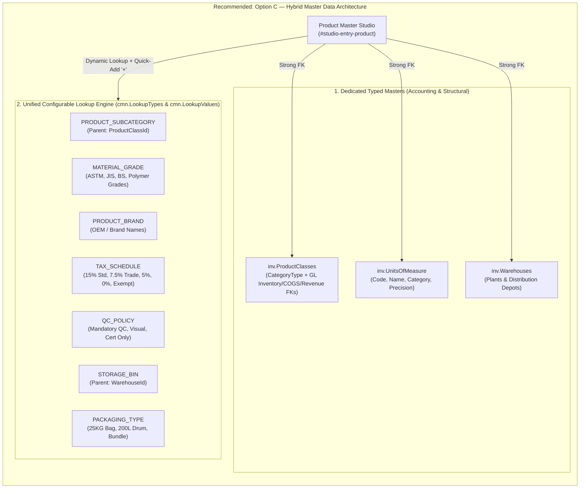

# Comprehensive Product Master Audit & Dynamic Master Data Management Plan

> [!IMPORTANT]
> **Phase Scope Boundary**: This document is strictly an audit, gap analysis, architectural specification, and implementation plan. **No application code, database schemas, existing records, routes, APIs, or UI components have been modified.** Execution will begin only after your review and explicit approval of the decisions in [Section L](#l-decisions-requiring-my-approval).

---

## A. Executive Summary

### 1. Current State Overview
An end-to-end inspection of the existing Product Master / Product Specification module across the frontend UI ([`index.html`](file:///d:/InteAcc/Dev/Projects/ERP/src/ERP.Web.Api/wwwroot/index.html#L5181-L5378)), client orchestration ([`erp-studios.js`](file:///d:/InteAcc/Dev/Projects/ERP/src/ERP.Web.Api/wwwroot/js/erp-studios.js#L2335-L2450)), API layer ([`ProductsController.cs`](file:///d:/InteAcc/Dev/Projects/ERP/src/ERP.Web.Api/Controllers/ProductsController.cs#L1-L162)), application service ([`InventoryService.cs`](file:///d:/InteAcc/Dev/Projects/ERP/src/ERP.Common.Infrastructure/Services/Inventory/InventoryService.cs#L1-L215)), domain models ([`Product.cs`](file:///d:/InteAcc/Dev/Projects/ERP/src/ERP.Common.Domain/Entities/Inventory/Product.cs#L1-L49), [`ProductClass.cs`](file:///d:/InteAcc/Dev/Projects/ERP/src/ERP.Common.Domain/Entities/Inventory/ProductClass.cs#L1-L27), [`UnitOfMeasure.cs`](file:///d:/InteAcc/Dev/Projects/ERP/src/ERP.Common.Domain/Entities/Inventory/UnitOfMeasure.cs#L1-L16)), and SQL schema ([`ProductConfiguration.cs`](file:///d:/InteAcc/Dev/Projects/ERP/src/ERP.Common.Infrastructure/Data/Configurations/Inventory/ProductConfiguration.cs#L1-L54), [`015_International_Product_Master_Enhancements.sql`](file:///d:/InteAcc/Dev/Projects/ERP/database/migrations/015_International_Product_Master_Enhancements.sql#L1-L131)) reveals a **partially modernized foundation with critical disconnects between the UI form, JavaScript payload assembly, and backend persistence**.

While migration `015` and [`Product.cs`](file:///d:/InteAcc/Dev/Projects/ERP/src/ERP.Common.Domain/Entities/Inventory/Product.cs) introduced several enterprise fields (HS Code, Net/Gross Weight, Dimensions, Tracking Policy, Costing Method, Safety Stock, Lead Time, Tax Rate, Default Warehouse), the frontend form (`#studio-entry-product`) and its submission logic ([`saveProductEntry`](file:///d:/InteAcc/Dev/Projects/ERP/src/ERP.Web.Api/wwwroot/js/erp-studios.js#L2335-L2450)) suffer from severe data-loss and hardcoding defects.

### 2. Major Gaps & Critical Risks Discovered
1. **Hardcoded Foreign Keys on Save (Critical Data Integrity Bug)**:
   - In [`saveProductEntry()`](file:///d:/InteAcc/Dev/Projects/ERP/src/ERP.Web.Api/wwwroot/js/erp-studios.js#L2400-L2401), `productClassId: 1` and `primaryUomId: 1` are **hardcoded** into the JSON payload. Regardless of which Item Category (`#prod-category`) or Base UOM (`#prod-uom`) the user selects in the UI, every product is saved to the database with `ProductClassId = 1` and `PrimaryUomId = 1`.
2. **Broken Edit Workflow (Create-Only Submission)**:
   - Clicking **Edit** on the product list calls [`editProductRecord(code, name, cost, price, uom)`](file:///d:/InteAcc/Dev/Projects/ERP/src/ERP.Web.Api/wwwroot/js/erp-studios.js#L6460-L6473), which populates only 4 inputs (`#prod-code`, `#prod-name`, `#prod-cost`, `#prod-wholesale`), leaving the remaining 11 form fields blank or reset to defaults.
   - Worse, [`saveProductEntry()`](file:///d:/InteAcc/Dev/Projects/ERP/src/ERP.Web.Api/wwwroot/js/erp-studios.js#L2423) **always issues `POST /api/inv/products`** instead of `PUT /api/inv/products/{id}`. Attempting to save an edited product either fails with a duplicate `ProductCode` constraint violation or creates a duplicate record.
3. **Unmapped & Silently Dropped UI Fields**:
   - **Minimum Retail List Price (`#prod-retail`)**: Exists in [`index.html`](file:///d:/InteAcc/Dev/Projects/ERP/src/ERP.Web.Api/wwwroot/index.html#L5332), is never read by `saveProductEntry()`, and has no column in `inv.Products`.
   - **Designated Storage Bay / Bin (`#prod-bin`)**: Read into a JS variable ([`line 2360`](file:///d:/InteAcc/Dev/Projects/ERP/src/ERP.Web.Api/wwwroot/js/erp-studios.js#L2360)) and shown in a browser `alert()`, but omitted from the API payload and absent from `inv.Products`.
   - **Inbound Inspection QC Mandate (`#prod-qc-toggle`)**: Read into JS ([`line 2361`](file:///d:/InteAcc/Dev/Projects/ERP/src/ERP.Web.Api/wwwroot/js/erp-studios.js#L2361)), omitted from the API payload, and absent from `inv.Products`.
   - **Default Receiving Warehouse (`#prod-warehouse`)**: Contains hardcoded string options (`"Central Warehouse"`) instead of database IDs; never mapped to `DefaultWarehouseId` in the API payload.
   - **Standard / Material Grade (`#prod-grade`)**: Misused by mapping into the `PackSize` column (`packSize: grade || 'Standard Spec'` at [`line 2402`](file:///d:/InteAcc/Dev/Projects/ERP/src/ERP.Web.Api/wwwroot/js/erp-studios.js#L2402)).
4. **Orphaned Backend Fields (Exist in DB & JS, Missing from Form HTML)**:
   - `saveProductEntry()` attempts to read `#prod-hs-code`, `#prod-net-weight`, `#prod-gross-weight`, `#prod-weight-uom`, `#prod-length`, `#prod-width`, `#prod-height`, `#prod-dim-uom`, `#prod-volume-cbm`, `#prod-tracking-policy`, and `#prod-costing-method` ([`lines 2341–2351`](file:///d:/InteAcc/Dev/Projects/ERP/src/ERP.Web.Api/wwwroot/js/erp-studios.js#L2341-L2351)), **none of which exist in `#studio-entry-product` in `index.html`**.
5. **100% Static / Hardcoded Dropdowns in Product Form**:
   - Even where backend master tables exist (`inv.ProductClasses`, `inv.UnitsOfMeasure`, `inv.Warehouses`), the `<select>` elements in `#studio-entry-product` are hardcoded in HTML with static text values and no inline `+ Add New` capability.
   - Several reference masters (`ProductClass` management UI, `TaxSchedule`, `StorageBin`, `MaterialGrade`, `Brand`) have no entry/list screens at all.

### 3. Recommended Strategic Direction
1. **Fix Immediate Data Integrity Defects (P0)**: Repair `saveProductEntry()` and `editProductRecord()` so Product Master supports full round-trip `POST` and `PUT` persistence with real foreign-key binding (`ProductClassId`, `PrimaryUomId`, `DefaultWarehouseId`).
2. **Adopt a Hybrid Master Data Architecture (Option C)**:
   - Use **dedicated strongly-typed tables and studios** for structural/accounting-critical masters: **Product Classes / Categories** (which bind to GL Inventory, COGS, and Revenue accounts), **Units of Measure & UOM Conversions**, **Tax / VAT Schedules**, and **Warehouse Storage Bins**.
   - Introduce a unified **Configurable Reference Data / Lookup Framework** (`cmn.LookupTypes` & `cmn.LookupValues`) for extensible classification and technical attributes (**Item Subcategories, Brands/Manufacturers, Material Grades/Standards, QC Inspection Policies, Packaging Types**).
3. **Dynamic Class-Driven UI & Inline Quick-Add (`+`)**:
   - Make `#studio-entry-product` dynamically show/hide technical vs. commercial sections based on the selected `ProductClass.CategoryType` (e.g., Raw Material / Structural Steel vs. Finished Goods vs. Service).
   - Add an authorized **inline `+` Quick-Add modal** beside every reference dropdown so users can create a missing UOM, Category, Grade, Bin, or Tax Schedule without losing their unsaved Product form state.

---

## B. Current-State Inventory

> [!NOTE]
> All findings below are **100% verified directly from the workspace source code and SQL migrations**. No assumptions were made.

### 1. End-to-End Field Mapping Inventory (UI vs. JS vs. API/Entity vs. Database)

| Section | UI Field Label | HTML Input ID | JS (`saveProductEntry`) Mapping | C# Entity (`Product.cs`) / DTO | SQL Column (`inv.Products`) | Current Status & Verified Finding |
| :--- | :--- | :--- | :--- | :--- | :--- | :--- |
| **Header** | Target Subsidiary Entity | `#prod-company-badge` | Uses `currentCompanyId` | `CompanyId` (`int`) | `CompanyId INT NOT NULL` | **Working** (Read-only badge synced with active company selector). |
| **1. Identity** | Product Item Code | `#prod-code` | `productCode: code` | `ProductCode` (`string`) | `ProductCode NVARCHAR(50) NOT NULL` | **Partial**: Unique per `(CompanyId, ProductCode)`. No auto-numbering sequence option. |
| **1. Identity** | Item Category | `#prod-category` | Read into `category`, **ignored in payload** (`productClassId: 1` hardcoded!) | `ProductClassId` (`int`) | `ProductClassId INT NOT NULL` | **Broken**: Dropdown has 5 hardcoded strings; always saves `ProductClassId = 1`. |
| **1. Identity** | Product Title / Description | `#prod-name` | `productName: name` | `ProductName` (`string`) | `ProductName NVARCHAR(200) NOT NULL` | **Working** on Create; single field conflates short title and detailed spec description. |
| **1. Identity** | Standard / Material Grade | `#prod-grade` | Mapped to `packSize: grade \|\| 'Standard Spec'` | `PackSize` (`string?`) | `PackSize NVARCHAR(50) NULL` | **Misused**: Material Grade is stuffed into `PackSize`; actual Pack Size has no UI input. |
| **2. Inventory** | Base Unit of Measure (UOM) | `#prod-uom` | Read into `uom`, **ignored in payload** (`primaryUomId: 1` hardcoded!) | `PrimaryUomId` (`int`) | `PrimaryUomId INT NOT NULL` | **Broken**: Dropdown has 6 hardcoded strings; always saves `PrimaryUomId = 1`. |
| **2. Inventory** | Reorder Level Threshold | `#prod-reorder` | `reorderLevel: reorder` | `ReorderLevel` (`decimal`) | `ReorderLevel DECIMAL(18,4) NOT NULL` | **Partial**: Saved globally on `Product`, whereas `inv.ProductStock` also has warehouse-level `ReorderLevel`. |
| **2. Inventory** | Safety Stock Floor Level | `#prod-safety-stock` | `safetyStock: safetyStock` | `SafetyStock` (`decimal`) | `SafetyStock DECIMAL(18,4) NOT NULL` | **Partial**: Saved on Create, not populated on Edit. |
| **2. Inventory** | Standard Procurement Lead Time | `#prod-lead-time` | `leadTimeDays: leadTime` | `LeadTimeDays` (`int`) | `LeadTimeDays INT NOT NULL` | **Partial**: Saved on Create, not populated on Edit. |
| **3. Commercial** | Standard Production Cost | `#prod-cost` | `standardCost: cost` | `StandardCost` (`decimal`) | `StandardCost DECIMAL(18,4) NOT NULL` | **Partial**: Saved on Create; backend sets `CurrentCost = StandardCost` on create, but `UpdateProductAsync` updates `CurrentCost` instead of `StandardCost`! |
| **3. Commercial** | Base Wholesale Rate | `#prod-wholesale` | `sellingPrice: wholesale` | `SellingPrice` (`decimal`) | `SellingPrice DECIMAL(18,4) NOT NULL` | **Partial**: Mapped to `SellingPrice`. |
| **3. Commercial** | Minimum Retail List Price | `#prod-retail` | **Not read by JS at all** | *None* | *None* | **Broken / Unmapped**: Input exists in HTML (`#prod-retail`), completely ignored by JS and backend. |
| **3. Commercial** | VAT Output Schedule | `#prod-vat-rate` | `taxRatePercent: vatRate * 100` | `TaxRatePercent` (`decimal`) | `TaxRatePercent DECIMAL(5,2) NOT NULL` | **Partial**: HTML stores `0.15`/`0.05`/`0.00`, JS multiplies by 100. Hardcoded options; no Tax Schedule FK. |
| **4. Warehouse** | Default Receiving Warehouse | `#prod-warehouse` | Read into `warehouse`, **omitted from payload** | `DefaultWarehouseId` (`int?`) | `DefaultWarehouseId INT NULL` | **Broken**: HTML has hardcoded strings (`"Central Warehouse"`); `DefaultWarehouseId` is always saved as `NULL`. |
| **4. Warehouse** | Designated Storage Bay / Bin | `#prod-bin` | Read into `bin`, **omitted from payload** | *None* (exists only on GRN lines) | *None* | **Broken / Unmapped**: Value shown in JS alert and discarded. |
| **4. Warehouse** | Inbound Inspection (QC) Mandate | `#prod-qc-toggle` | Read into `qc`, **omitted from payload** | *None* | *None* | **Broken / Unmapped**: Value discarded on save. |
| *Orphaned DB* | HS / Tariff Code | *Missing in HTML* (`#prod-hs-code` in JS) | `hsCode` (always `null`) | `HsCode` (`string?`) | `HsCode NVARCHAR(20) NULL` | **Orphaned**: DB column, DTO, and View Record exist; missing from `#studio-entry-product`. |
| *Orphaned DB* | Net / Gross Weight & Weight UOM | *Missing in HTML* (`#prod-net-weight`, etc.) | `netWeight`, `grossWeight`, `weightUom` | `NetWeight`, `GrossWeight`, `WeightUom` | `DECIMAL(18,4)`, `NVARCHAR(20)` | **Orphaned**: DB column, DTO, and View Record exist; missing from `#studio-entry-product`. |
| *Orphaned DB* | Dimensions (`L`, `W`, `H`, `UOM`, `CBM`) | *Missing in HTML* (`#prod-length`, etc.) | `length`, `width`, `height`, `dimensionUom`, `volumeCbm` | `Length`, `Width`, `Height`, `DimensionUom`, `VolumeCbm` | `DECIMAL(18,4)`, `NVARCHAR(20)` | **Orphaned**: DB column, DTO, and View Record exist; missing from `#studio-entry-product`. |
| *Orphaned DB* | Batch / Serial Tracking Policy | *Missing in HTML* (`#prod-tracking-policy`) | `trackingPolicy` (defaults to `1`) | `TrackingPolicy` (`TrackingPolicy` enum) | `TrackingPolicy INT NOT NULL` | **Orphaned**: DB column (`1=None, 2=Batch, 3=Serial`) exists; missing from `#studio-entry-product`. |
| *Orphaned DB* | Inventory Costing Method | *Missing in HTML* (`#prod-costing-method`) | `costingMethod` (defaults to `'MovingAverage'`) | `CostingMethod` (`string`) | `CostingMethod NVARCHAR(30) NOT NULL` | **Orphaned**: DB column exists; missing from `#studio-entry-product`. |
| *Orphaned DB* | Active Lifecycle Flag | *Missing in HTML* | Not sent on Create; sent on Update DTO | `IsActive` (`bool`) | `IsActive BIT NOT NULL` | **Orphaned**: Cannot toggle Active/Inactive from Product form. |

### 2. Existing Database Tables, APIs, and UI Pages Related to Product Master

1. **`inv.Products`** ([`Product.cs`](file:///d:/InteAcc/Dev/Projects/ERP/src/ERP.Common.Domain/Entities/Inventory/Product.cs), [`ProductConfiguration.cs`](file:///d:/InteAcc/Dev/Projects/ERP/src/ERP.Common.Infrastructure/Data/Configurations/Inventory/ProductConfiguration.cs)):
   - **APIs**: `GET /api/inv/products`, `GET /api/inv/products/{id}`, `POST /api/inv/products`, `PUT /api/inv/products/{id}`, `DELETE /api/inv/products/{id}` ([`ProductsController.cs`](file:///d:/InteAcc/Dev/Projects/ERP/src/ERP.Web.Api/Controllers/ProductsController.cs)).
   - **UI Pages**: `#studio-list-products` (List), `#studio-entry-product` (Create/Edit), `#studio-view-record` (Read-only dossier).
   - **Dependencies**: Referenced by `inv.ProductStock`, `inv.StockLedger`, `inv.GoodsReceiptNoteLines`, `inv.GoodsReceiptReturnLines`, `inv.StockAdjustmentLines`, `inv.StockTransferLines`, `prc.PurchaseOrderLines`, `prc.PurchaseBillLines`, `sal.SalesOrderLines`, `sal.DeliveryChallanLines`, `ar.InvoiceLines`, `mfg.BillsOfMaterials`, `mfg.BomComponents`, and `mfg.ProductionOrders`.
2. **`inv.ProductClasses`** ([`ProductClass.cs`](file:///d:/InteAcc/Dev/Projects/ERP/src/ERP.Common.Domain/Entities/Inventory/ProductClass.cs), [`InventoryConfigurations.cs`](file:///d:/InteAcc/Dev/Projects/ERP/src/ERP.Common.Infrastructure/Data/Configurations/Inventory/InventoryConfigurations.cs#L12-L26)):
   - **Columns**: `Id`, `CompanyId`, `ClassCode` (`NVARCHAR(20)`), `ClassName` (`NVARCHAR(100)`), `CategoryType` (`InventoryCategoryType`: `1=RawMaterial, 2=WorkInProgress, 3=FinishedGood, 4=SparePart, 5=Service`), `GlInventoryAccountId`, `GlCogsAccountId`, `GlRevenueAccountId`, `IsActive`, plus audit/soft-delete columns.
   - **APIs**: `GET /api/inv/products/classes`, `POST /api/inv/products/classes` (No `PUT` or `DELETE`).
   - **UI Pages**: **None** (No list studio, no entry studio, and not bound to `#prod-category`).
3. **`inv.UnitsOfMeasure`** ([`UnitOfMeasure.cs`](file:///d:/InteAcc/Dev/Projects/ERP/src/ERP.Common.Domain/Entities/Inventory/UnitOfMeasure.cs), [`InventoryConfigurations.cs`](file:///d:/InteAcc/Dev/Projects/ERP/src/ERP.Common.Infrastructure/Data/Configurations/Inventory/InventoryConfigurations.cs#L28-L39)):
   - **Columns**: `Id`, `CompanyId`, `UomCode` (`NVARCHAR(10)`), `UomName` (`NVARCHAR(50)`), plus audit/soft-delete columns.
   - **APIs**: `GET /api/inv/products/uoms`, `POST /api/inv/products/uoms` (No `PUT` or `DELETE`).
   - **UI Pages**: `#studio-list-uoms` and `#studio-entry-uom` exist! However, `#studio-entry-uom` collects `uom-category` (Mass, Length, Volume, etc.), `uom-precision`, and `uom-is-base`, which are **only stored in client memory (`LIVE_UOM_DATA`)** because `UnitOfMeasure.cs` only has `UomCode` and `UomName`. Furthermore, `#prod-uom` in the Product form is not populated from `/api/inv/products/uoms`.
4. **`inv.Warehouses`** ([`Warehouse.cs`](file:///d:/InteAcc/Dev/Projects/ERP/src/ERP.Common.Domain/Entities/Inventory/Warehouse.cs)):
   - **APIs**: `GET /api/inv/products/warehouses`, `POST /api/inv/products/warehouses`.
   - **UI Pages**: `#studio-list-warehouses`, `#studio-entry-warehouse`, `#studio-list-plants`, `#studio-list-depots`, `#studio-entry-depot`.
   - **Gap**: `#prod-warehouse` in `#studio-entry-product` is still hardcoded HTML instead of binding to `GET /api/inv/products/warehouses`.

---

## C. Standards and Best-Practice Gap Analysis

We evaluated the current implementation against **ISO 8000** (Master Data Quality & Governance), **ISO 9001** (Quality Management & Traceability), **GS1** (Global Trade Item Identification & Barcoding), **IAS 2 / IFRS** (Inventory Valuation & Costing), and multi-subsidiary manufacturing/trading ERP patterns (PEB Structural Steel, Polymer, Furniture, and Commercial Trading).

### 1. Standards Distinction Matrix
- **Explicit Regulatory / Accounting Standard Requirements**:
  - **IAS 2 (Inventories)**: Requires clear distinction between Cost Valuation Method (`FIFO`, `Weighted Average`, `Standard Cost`), Standard Cost vs. Actual Moving Average Cost, Net Realizable Value comparison (Selling Price vs. Cost), and linkage to GL Asset (`GlInventoryAccountId`), Expense (`GlCogsAccountId`), and Revenue (`GlRevenueAccountId`) accounts via `ProductClass`.
  - **VAT / Customs Compliance (NBR Bangladesh / WCO)**: Requires accurate **HS Code** (6–8 digit Harmonized System tariff code) and configurable **VAT / Tax Schedule** (Standard 15%, Truncated/Trade 5% or 7.5%, Zero-Rated 0%, VAT Exempt) rather than a single hardcoded percentage.
  - **ISO 9001 (Clauses 8.5.2 & 8.6 — Identification, Traceability & Release of Products)**: Requires explicit **Tracking Policy** (None, Batch/Lot/Heat Number, Serial Number) and **Inbound/Outbound QC Inspection Policy** for structural steel, chemicals/polymers, and manufactured goods.
- **Common Enterprise ERP Best Practices (SAP MM / Oracle NetSuite / Microsoft Dynamics 365)**:
  - Separating **Item Master Core Attributes** from **Warehouse-Specific Stock/Replenishment Parameters** (`inv.ProductStock`) and **Effective-Dated Commercial Price Lists**.
  - Maintaining **Dual/Multi-UOM Conversions** (e.g., purchasing steel coils in `MT`, stocking in `KG` or `Sheet`, selling in `PCS` or `Linear Meter`).
  - Controlled **Lifecycle Status** (`Draft`, `Active`, `Hold/Obsolete`, `Discontinued`) instead of a hidden boolean.
- **Industry-Specific Requirements (Conditional by Product Class)**:
  - *Structural Steel / PEB*: Material Standard/Grade (e.g., `ASTM A572 Gr.50`, `JIS G3101 SS400`), Thickness/Dimensions, Theoretical Weight per Unit/Meter, Heat/Mill Certificate Mandate.
  - *Polymer / Chemicals*: Resin Grade, Shelf-Life / Expiry Date Tracking, Packaging Size (`25 KG Bag`, `200L Drum`).
  - *Furniture / Retail / Trading*: Brand, Model/Style, Color/Finish, Barcode/GTIN, Minimum Retail Price (MRP), Warranty Period.

### 2. Field & Capability Classification Matrix

| Capability / Field Area | Classification | Rationale & Findings |
| :--- | :--- | :--- |
| **Multi-Tenant Scoping (`CompanyId`)** | **Compliant / Appropriate** | Enforced via `IMultiTenant` global query filter and composite unique index `(CompanyId, ProductCode)`. |
| **Audit Trail & Soft Delete (`IAuditableEntity`, `ISoftDeletable`)** | **Compliant / Appropriate** | `ErpDbContext.SaveChangesAsync` automatically intercepts deletes into soft-deletes (`IsDeleted = true`) and logs field-level JSON diffs into `sys.AuditLogs`. |
| **Product Code (`ProductCode`)** | **Needs Improvement** | Supports manual entry with uniqueness validation, but lacks optional prefix-based auto-sequencing (via `sys.DocumentSequences`) per Product Class. |
| **ProductClass & GL Account Integration** | **Needs Improvement** | Backend entity `ProductClass` is well-designed (links to `InventoryCategoryType` and GL Inventory/COGS/Revenue accounts), but UI hardcodes `productClassId: 1` and lacks a Product Class management studio. |
| **Product Name vs. Technical Description** | **Needs Improvement** | Single `ProductName` (`NVARCHAR(200)`) conflates display title and technical description. Should split into `ProductName` (Title) and `Description` / `SpecificationSummary`. |
| **Base UOM & Multi-UOM Conversion** | **Needs Improvement** | Base UOM table exists, but product form is hardcoded, and there is no `PurchaseUomId`, `SalesUomId`, or `inv.UomConversions` table for cross-UOM transactions. |
| **Commercial Pricing (`StandardCost`, `SellingPrice`, `MinRetailPrice`)** | **Needs Improvement** | Storing **Baseline/Default Standard Cost, Wholesale Price, and Minimum Retail Price (MRP)** on `inv.Products` is practical for fast ERP operation, **provided** `CurrentCost` (moving average) is system-controlled via GRN/Production costing and effective-dated price revisions are logged or managed via price lists. Currently, `UpdateProductAsync` overwrites `CurrentCost` with `StandardCost` (violating IAS 2 if stock exists) and `MinRetailPrice` is dropped. |
| **Reorder Level & Safety Stock** | **Needs Improvement** | Global `ReorderLevel` and `SafetyStock` on `inv.Products` are useful as **product-wide defaults**, which should seed or fall back to warehouse-specific `inv.ProductStock.ReorderLevel` and `SafetyStock`. |
| **VAT Output Schedule** | **Needs Improvement** | Currently stores raw `TaxRatePercent` (`15.00`) from a hardcoded dropdown. Needs a reference `TaxScheduleId` (supporting Standard VAT, Reduced Rate, Zero-Rated, Exempt, and HS-Code-linked tax rules) while retaining `TaxRatePercent` for backward compatibility. |
| **Default Warehouse & Storage Bin** | **Needs Improvement** | `DefaultWarehouseId` exists on `Product` but is not bound in UI; `DefaultStorageBinId` / `StorageBinCode` is missing from `Product` and lacks a master table under `Warehouse`. |
| **Inbound QC Inspection Policy** | **Missing (Backend)** | Present in UI (`#prod-qc-toggle`), completely missing from `Product.cs` and `inv.Products`. |
| **Material Grade / Standard vs. Pack Size** | **Needs Improvement** | Currently `MaterialGrade` overwrites `PackSize`! They are distinct concepts: `MaterialGrade` (e.g., `ASTM A36`) and `PackSize` (e.g., `25 KG Bag`). Both should be distinct columns backed by configurable lookups. |
| **Subcategory, Brand, Barcode / GTIN** | **Missing** | Essential for classifying items within broad Product Classes (e.g., Class: `Raw Material` -> Subcategory: `HR Coil` / `Fasteners`) and scanning traded/finished goods (GS1 GTIN/EAN-13). |
| **Eligibility Flags (`IsPurchasable`, `IsSellable`, `IsStockItem`, `IsManufactured`)** | **Missing** | Raw materials shouldn't appear on standard retail Sales Order lookups unless allowed; Services shouldn't track physical stock; Finished Goods may be manufactured (`IsManufactured = true`). |
| **Lifecycle Status (`Draft`, `Active`, `Inactive`, `Discontinued`)** | **Needs Improvement** | Currently only `IsActive BIT`. Adding a `LifecycleStatus` (while keeping `IsActive` synced for existing queries) prevents premature transactions on draft specs or new POs on discontinued items. |

---

## D. Proposed Product Master Specification

### 1. Architectural Decisions on Commercial Pricing & Stock Parameters
- **Commercial Values (Cost & Prices)**:
  - **Recommended Hybrid Approach**: Retain `StandardCost`, `SellingPrice` (Base Wholesale Rate), and add `MinimumRetailPrice` directly on `inv.Products` as the **active baseline commercial rates** so Purchase Orders, Sales Orders, and POS/Invoices work immediately without complex joins.
  - **Accounting & Audit Safeguard**:
    1. `CurrentCost` (Moving Average / Actual Valuation Cost) must be **read-only in the UI** and updated strictly by Inventory Valuation events (GRN Posting, Landed Cost, Production Receipt, Cost Revaluation).
    2. Whenever `StandardCost`, `SellingPrice`, or `MinimumRetailPrice` is changed on `inv.Products`, automatically append an immutable record to `inv.ProductPriceHistory` (recording `OldValue`, `NewValue`, `EffectiveFromUtc`, `ChangedBy`) in addition to `sys.AuditLogs`.
- **Replenishment Controls (`ReorderLevel`, `SafetyStock`, `LeadTimeDays`)**:
  - Maintain `ReorderLevel`, `SafetyStock`, and `LeadTimeDays` on `inv.Products` as **Company-Wide Default Thresholds**.
  - When a product is initialized in a warehouse (`inv.ProductStock`), default its warehouse-level `ReorderLevel` and `SafetyStock` from `inv.Products`, while allowing warehouse managers to override thresholds per Plant/Depot in `inv.ProductStock`.

### 2. Complete Proposed Product Master Field Catalogue

| # | Field Name (C# / DB) | Proposed Display Label | Business Definition | Data Type & Precision | Status (M / O / C) | Default Value | Validation & Uniqueness Rules | Data Source | Applicable Product Classes | Conditional Visibility & Dependencies | Editable After Creation? | Audit History | Justification / Standard |
| :- | :--- | :--- | :--- | :--- | :--- | :--- | :--- | :--- | :--- | :--- | :--- | :--- | :--- |
| **1** | `CompanyId` | Target Subsidiary Entity | Legal subsidiary owning the product catalogue record. | `INT` | **M** | Active `CompanyId` | Must exist in `sys.Companies`; user must have access. | System Context | All Classes | Always visible (read-only header badge). | **No** (Immutable tenant key) | Yes | Multi-tenant isolation. |
| **2** | `ProductCode` | Product Item Code (SKU) | Unique alphanumeric identifier for the item within the subsidiary. | `NVARCHAR(50)` | **M** | Auto-generated or Manual | Unique per `(CompanyId, ProductCode)` where `IsDeleted = 0`. Regex `^[A-Z0-9\-_.\/]{2,50}$`. | System Sequence or Manual | All Classes | Always visible. | **Locked** once any Stock Ledger, PO, GRN, or SO line exists. | Yes | ISO 8000 / GS1 SKU integrity. |
| **3** | `BarcodeGtin` | Barcode / GTIN | GS1 Global Trade Item Number (EAN-13, UPC, Code-128) for scanner integration. | `NVARCHAR(50)` NULL | **O** | `NULL` | Unique per `(CompanyId, BarcodeGtin)` when not null. | Manual / Scanner | Finished Goods, Spare Parts, Traded Goods | Hidden for Services. | Yes | Yes | GS1 Barcode Standard. |
| **4** | `ProductClassId` | Product Class (GL Category) | Primary accounting & operational classification defining GL Inventory, COGS, and Revenue accounts. | `INT` (FK to `inv.ProductClasses`) | **M** | `NULL` (User must select) | Must reference active `inv.ProductClasses.Id` in same company. | Reference Table (`inv.ProductClasses`) | All Classes | Always visible. Drives conditional visibility of technical fields. | **Restricted** (Locked if posted GL/Stock transactions exist). | Yes | IAS 2 Accounting integration. |
| **5** | `SubcategoryId` | Item Subcategory | Granular functional grouping under Product Class (e.g., *HR Coil*, *Fasteners*, *Office Desk*). | `INT` NULL (FK to `cmn.LookupValues`) | **O** | `NULL` | Must belong to LookupType `PRODUCT_SUBCATEGORY`. | Reference Table (`cmn.LookupValues`) | All Classes | Filtered optionally by parent `ProductClassId`. | Yes | Yes | ISO 8000 taxonomy hierarchy. |
| **6** | `BrandId` | Brand / Manufacturer | Commercial brand or OEM manufacturer name. | `INT` NULL (FK to `cmn.LookupValues`) | **O** | `NULL` | Must belong to LookupType `PRODUCT_BRAND`. | Reference Table (`cmn.LookupValues`) | Finished Goods, Spare Parts, Raw Materials | Hidden for Services. | Yes | Yes | Enterprise PDM standard. |
| **7** | `ProductName` | Product Title | Official concise name printed on POs, GRNs, Delivery Challans, and Invoices. | `NVARCHAR(200)` | **M** | `""` | Length 3–200 chars; non-whitespace. | Manual Input | All Classes | Always visible. | Yes | Yes | Core ERP identifier. |
| **8** | `Description` | Technical Description / Specification | Extended specification details, tolerances, or scope of work. | `NVARCHAR(500)` NULL | **O** | `NULL` | Max 500 chars. | Manual Input | All Classes | Always visible. | Yes | Yes | Prevents cluttering `ProductName`. |
| **9** | `MaterialGrade` | Standard / Material Grade | Metallurgical, chemical, or quality standard (e.g., `ASTM A572 Gr.50`, `HDPE Film Grade`). | `NVARCHAR(100)` NULL | **C** | `NULL` | Selected from lookup `MATERIAL_GRADE` or custom text if allowed. | Reference Table (`cmn.LookupValues`) | Raw Materials, WIP, Structural Steel, Finished Goods | Hidden for Services; highlighted for Raw Material / WIP. | Yes | Yes | ISO 9001 engineering spec control. |
| **10** | `PackSize` | Standard Pack Size | Physical packaging configuration (e.g., `25 KG Bag`, `200L Drum`, `Bundle of 10`). | `NVARCHAR(50)` NULL | **O** | `NULL` | Max 50 chars; selectable from `PACKAGING_TYPE` lookup. | Reference Table / Manual | All Physical Items | Hidden for Services. | Yes | Yes | Separates Pack Size from Material Grade. |
| **11** | `HsCode` | HS / Tariff Code | Harmonized System customs tariff code (6–10 digits) for import/export & VAT schedules. | `NVARCHAR(20)` NULL | **C** | `NULL` | Regex `^[0-9\.]{4,20}$`. | Reference Table (`HS_CODE`) or Manual | All Physical Items | Hidden for Services. | Yes | Yes | WCO / NBR VAT & Customs standard. |
| **12** | `PrimaryUomId` | Base Unit of Measure | Fundamental stocking unit in which all `inv.ProductStock` and `inv.StockLedger` quantities are tracked. | `INT` (FK to `inv.UnitsOfMeasure`) | **M** | `NULL` | Must reference active `inv.UnitsOfMeasure.Id`. | Reference Table (`inv.UnitsOfMeasure`) | All Classes | Always visible. | **Locked** once any transaction exists for the product. | Yes | Inventory quantity integrity. |
| **13** | `SecondaryUomId` | Secondary / Alt UOM | Optional secondary unit for purchasing or sales (e.g., purchase in `MT`, stock in `KG`). | `INT` NULL (FK to `inv.UnitsOfMeasure`) | **O** | `NULL` | If set, `UomConversionFactor` must be `> 0`. | Reference Table (`inv.UnitsOfMeasure`) | All Physical Items | Visible when Multi-UOM is enabled or expanded. | Yes (if no open conversion lock) | Yes | Multi-UOM procurement/sales. |
| **14** | `UomConversionFactor` | Alt UOM Conversion Factor | Multiplier: `1 SecondaryUOM = N PrimaryUOM` (e.g., `1 MT = 1000 KG`). | `DECIMAL(18,6)` NULL | **C** | `1.000000` | Mandatory and `> 0` when `SecondaryUomId` is selected. | Manual Input | All Physical Items | Visible only when `SecondaryUomId` is selected. | Yes | Yes | Prevents rounding drift in steel/bulk items. |
| **15** | `TrackingPolicy` | Traceability / Tracking Policy | Controls whether inventory movements require Batch/Heat Numbers or Serial Numbers. | `INT` (`TrackingPolicy` Enum) | **M** | `1` (`None`) | `1 = None`, `2 = Batch/Heat Tracked`, `3 = Serial Tracked`. | System Enum Dropdown | All Physical Items | Forced to `1 (None)` for Services. | **Locked** if `ProductStock.OnHandQty != 0`. | Yes | ISO 9001 Clause 8.5.2 Traceability. |
| **16** | `QcPolicy` | Inbound Inspection (QC) Mandate | Determines whether GRNs require formal QA/QC clearance before stock becomes unrestricted. | `NVARCHAR(50)` | **M** | `'Visual Inspection'` | Values from `QC_POLICY` lookup (`Mandatory QC`, `Sampling Inspection`, `Visual Inspection`, `Skip Lot / Cert Only`). | Reference Table (`cmn.LookupValues`) | All Physical Items | Hidden for Services. | Yes | Yes | ISO 9001 Clause 8.6 Release of products. |
| **17** | `ReorderLevel` | Default Reorder Point | Minimum stock quantity that triggers a replenishment alert when available stock falls below it. | `DECIMAL(18,4)` | **M** | `0.0000` | Must be `>= 0` and `>= SafetyStock`. | Manual Input | All Physical Items | Hidden for Services. | Yes | Yes | Supply chain planning control. |
| **18** | `SafetyStock` | Safety Stock Floor | Buffer stock quantity reserved against demand spikes or supplier delays. | `DECIMAL(18,4)` | **M** | `0.0000` | Must be `>= 0` and `<= ReorderLevel` (warning if `> ReorderLevel`). | Manual Input | All Physical Items | Hidden for Services. | Yes | Yes | Supply chain risk buffer. |
| **19** | `LeadTimeDays` | Standard Lead Time (Days) | Average calendar days from Purchase Requisition/PO release to warehouse receipt. | `INT` | **M** | `7` | Integer `0` to `3650`. | Manual Input | All Physical Items | Hidden for Services. | Yes | Yes | MRP lead-time calculation. |
| **20** | `CostingMethod` | Inventory Valuation Method | Accounting formula used to value inventory and calculate COGS. | `NVARCHAR(30)` | **M** | `'MovingAverage'` | Allowed: `'MovingAverage'`, `'FIFO'`, `'StandardCost'`. | Controlled Dropdown | All Physical Items | Hidden for Services. | **Locked** once stock movements exist. | Yes | IAS 2 Inventory Valuation. |
| **21** | `StandardCost` | Standard / Baseline Cost | Budgeted production cost or standard landed purchase cost per Base UOM (in BDT). | `DECIMAL(18,4)` | **M** | `0.0000` | Must be `>= 0`. | Manual Input | All Classes | Always visible. | Yes (Logs to `ProductPriceHistory`). | Yes + Price History | Standard cost benchmarking. |
| **22** | `CurrentCost` | Current Valuation Cost | Live Moving Average / Actual unit cost maintained by GRN and Production postings. | `DECIMAL(18,4)` | **System** | Equals `StandardCost` on create | `>= 0`. Read-only in UI after creation. | System Calculated | All Physical Items | Shown as read-only metric in Edit/View mode. | **No** (Updated only by valuation engine). | Yes | IAS 2 valuation integrity. |
| **23** | `SellingPrice` | Base Wholesale Rate | Default B2B / dealer unit selling price (excluding VAT) per Base UOM. | `DECIMAL(18,4)` | **M** | `0.0000` | Must be `>= 0`. Warning if `< StandardCost` when `IsSellable = true`. | Manual Input | Finished Goods, Traded, Spare Parts, Services | Optional (`0.00`) for internal Raw Materials/WIP. | Yes (Logs to `ProductPriceHistory`). | Yes + Price History | Order-to-Cash baseline pricing. |
| **24** | `MinimumRetailPrice` | Minimum Retail List Price (MRP) | Recommended retail list price or floor price per Base UOM. | `DECIMAL(18,4)` | **O** | `0.0000` | Must be `>= 0`. | Manual Input | Finished Goods, Traded Goods | Optional for Raw Materials. | Yes (Logs to `ProductPriceHistory`). | Yes + Price History | Restores unmapped `#prod-retail` field. |
| **25** | `TaxScheduleId` & `TaxRatePercent` | VAT Output Schedule | Applicable VAT / tax rate schedule for sales and procurement billing. | `INT` NULL FK + `DECIMAL(5,2)` | **M** | `15.00` (Standard VAT) | `TaxRatePercent` between `0.00` and `100.00`, synced from selected `TaxSchedule`. | Reference Table (`cmn.LookupValues` / `TaxSchedules`) | All Classes | Always visible. | Yes | Yes | NBR VAT compliance. |
| **26** | `DefaultWarehouseId` | Default Receiving Facility | Primary Plant or Depot where inbound deliveries or production outputs are received by default. | `INT` NULL (FK to `inv.Warehouses`) | **O** | `NULL` | Must reference active `inv.Warehouses.Id` in same company. | Reference Table (`inv.Warehouses`) | All Physical Items | Hidden for Services. | Yes | Yes | Fixes unmapped `#prod-warehouse`. |
| **27** | `DefaultStorageBin` | Designated Storage Bay / Bin | Default rack, zone, yard, or bay identifier inside the Default Receiving Facility. | `NVARCHAR(50)` NULL | **O** | `NULL` | Validated against `inv.StorageBins` (if configured for warehouse) or Lookup/Text. | Reference Table (`inv.StorageBins`) / Lookup | All Physical Items | Filtered by selected `DefaultWarehouseId`. | Yes | Yes | Fixes unmapped `#prod-bin` field. |
| **28** | `NetWeight`, `GrossWeight`, `WeightUom` | Unit Net & Gross Weight | Physical mass per Base UOM for freight, crane load, and structural calculations. | `DECIMAL(18,4)` NULL, `NVARCHAR(20)` | **O** | `0.0000`, `'KG'` | `GrossWeight >= NetWeight >= 0`. | Manual + UOM Lookup | Physical Items | Collapsible "Physical Dimensions & Weight" panel. | Yes | Yes | Exposes existing DB columns in UI. |
| **29** | `Length`, `Width`, `Height`, `DimensionUom`, `VolumeCbm` | Physical Dimensions & CBM | Linear dimensions and auto-calculated Cubic Meter (`CBM`) volume per unit. | `DECIMAL(18,4)` NULL, `NVARCHAR(20)` | **O** | `NULL`, `'MM'` | All dimensions `>= 0`; `VolumeCbm` auto-computed from `L × W × H`. | Manual + Auto-Calc | Physical Items | Collapsible "Physical Dimensions & Weight" panel. | Yes | Yes | Exposes existing DB columns in UI. |
| **30** | `IsPurchasable`, `IsSellable`, `IsManufactured` | Operational Eligibility Flags | Controls whether the item can be selected on Purchase Orders, Sales Invoices, or BOM/Production Orders. | `BIT` (`bool`) | **M** | Derived from `ProductClass.CategoryType` | At least one flag must be `true`. | Auto-defaulted + User Toggle | All Classes | Defaulted automatically when `ProductClass` changes. | Yes | Yes | Prevents invalid cross-module selection. |
| **31** | `LifecycleStatus` & `IsActive` | Lifecycle Status | Controls operational availability: `Draft`, `Active`, `Inactive`, `Discontinued`. | `NVARCHAR(20)` + `BIT` | **M** | `'Active'`, `1` | `IsActive` automatically set to `true` when `LifecycleStatus == 'Active'`, else `false`. | Controlled Dropdown | All Classes | Always visible in header/status bar. | Yes | Yes | Governance & safe deactivation. |

---

## E. Dropdown and Master Data Gap Matrix

The table below audits every dropdown, lookup, and reference control required by Product Master, comparing its current state against the target architecture.

| Master Data Type | Existing Table/API | Entry Page | List Page | Edit/Status Management | Current Gap | Recommended Solution |
| :--- | :--- | :--- | :--- | :--- | :--- | :--- |
| **1. Base & Secondary UOM** (`#prod-uom`, `#prod-weight-uom`, `#prod-dim-uom`) | **Table**: `inv.UnitsOfMeasure`<br>**API**: `GET/POST /api/inv/products/uoms` | **Exists**: `#studio-entry-uom` | **Exists**: `#studio-list-uoms` | **Missing**: No `PUT` or `DELETE`/Status toggle API in `ProductsController.cs`; UI edits only update in-memory `LIVE_UOM_DATA`. | 1. `#prod-uom` in `index.html` has 6 hardcoded strings (`MT`, `KG`, `PCS`...) and `saveProductEntry()` hardcodes `primaryUomId: 1`.<br>2. `UomCategory` (`Mass`, `Length`, `Unit`), `DecimalPrecision`, and `IsActive` in `#studio-entry-uom` are not persisted in `inv.UnitsOfMeasure`. | 1. Add `UomCategory`, `DecimalPrecision`, and `IsActive` to `inv.UnitsOfMeasure` + add `PUT/DELETE` endpoints.<br>2. Dynamically bind `#prod-uom` to `GET /api/inv/products/uoms` using `uom.id` as `<option value>`.<br>3. Add inline `+` Quick-Add button next to `#prod-uom`. |
| **2. Item Category / Product Class** (`#prod-category`) | **Table**: `inv.ProductClasses`<br>**API**: `GET/POST /api/inv/products/classes` | **Missing** | **Missing** | **Missing**: No `PUT` or `Status` API; no UI to map `CategoryType` or GL Accounts (`GlInventoryAccountId`, `GlCogsAccountId`, `GlRevenueAccountId`). | 1. `#prod-category` in `index.html` has 5 hardcoded strings.<br>2. `saveProductEntry()` ignores `#prod-category` and hardcodes `productClassId: 1`.<br>3. Users cannot create or manage Product Classes or their GL account mappings in UI. | 1. Build dedicated **Product Classes Studio** (`#studio-list-product-classes` & `#studio-entry-product-class`) with `CategoryType` and GL Account dropdowns.<br>2. Add `PUT /api/inv/products/classes/{id}`.<br>3. Bind `#prod-category` dynamically to `inv.ProductClasses` + add inline `+` Quick-Add modal. |
| **3. Item Subcategory** (`#prod-subcategory`) | **None** | **Missing** | **Missing** | **Missing** | No way to group products under a Product Class (e.g., separating *Steel Plates*, *Steel Sections*, and *Welding Consumables* inside `Raw Materials`). | Manage via the new **Dynamic Reference Data Framework** (`cmn.LookupValues` where `LookupType = 'PRODUCT_SUBCATEGORY'`, supporting optional parent link to `ProductClassId`) + inline `+` Quick-Add modal. |
| **4. Brand / Manufacturer** (`#prod-brand`) | **None** | **Missing** | **Missing** | **Missing** | No brand or OEM manufacturer attribution for finished goods, furniture, spare parts, or traded items. | Manage via **Dynamic Reference Data Framework** (`LookupType = 'PRODUCT_BRAND'`) + inline `+` Quick-Add modal. |
| **5. Standard / Material Grade** (`#prod-grade`) | **None** (Currently overwrites `inv.Products.PackSize`!) | **Missing** | **Missing** | **Missing** | Free-text field `#prod-grade` overwrites `PackSize` in `saveProductEntry()`. Prone to typos (`ASTM A36` vs `A-36` vs `astm a36`). | 1. Add dedicated `MaterialGrade` column on `inv.Products`.<br>2. Convert `#prod-grade` into a searchable combo/select backed by `LookupType = 'MATERIAL_GRADE'` + inline `+` Quick-Add modal. |
| **6. Standard Pack Size** (`#prod-pack-size`) | **Column Only**: `inv.Products.PackSize` | **Missing** | **Missing** | **Missing** | Column exists in DB (`PackSize NVARCHAR(50)`), but was hijacked by `#prod-grade` in JS and has no input of its own in `#studio-entry-product`. | Restore dedicated `#prod-pack-size` input backed by `LookupType = 'PACKAGING_TYPE'` (e.g., `Loose / Bulk`, `25 KG Bag`, `200L Drum`, `Bundle`) + inline `+` Quick-Add. |
| **7. VAT / Tax Output Schedule** (`#prod-vat-rate`) | **Column Only**: `inv.Products.TaxRatePercent` | **Missing** | **Missing** | **Missing** | `#prod-vat-rate` has 3 hardcoded options (`15%`, `5%`, `0%`). Cannot configure new NBR VAT schedules (e.g., `7.5% Trade VAT`, `VAT Exempt`) from UI. | Manage via **Dynamic Reference Data Framework** (`LookupType = 'TAX_SCHEDULE'` with numeric `NumericValue` for rate `%`) so selecting a schedule sets both `TaxScheduleCode` and `TaxRatePercent` + inline `+` Quick-Add. |
| **8. Default Receiving Warehouse** (`#prod-warehouse`) | **Table**: `inv.Warehouses`<br>**API**: `GET/POST /api/inv/products/warehouses` | **Exists**: `#studio-entry-warehouse` & `#studio-entry-depot` | **Exists**: `#studio-list-warehouses`, `#studio-list-plants`, `#studio-list-depots` | **Partial**: Create & List exist; needs `PUT` endpoint for editing warehouses. | `#prod-warehouse` in `index.html` has 3 hardcoded string options (`Central Warehouse`, `Raw Material Silo`, `Finished Goods Yard`) and is **not sent in the save payload**, leaving `DefaultWarehouseId = NULL`. | 1. Dynamically populate `#prod-warehouse` from `GET /api/inv/products/warehouses` (`value = warehouse.id`, grouped by Plant vs. Depot).<br>2. Map selected integer ID to `defaultWarehouseId` in `saveProductEntry()`.<br>3. Add inline `+` Quick-Add modal. |
| **9. Designated Storage Bay / Bin** (`#prod-bin`) | **None** (Free-text on GRN lines only) | **Missing** | **Missing** | **Missing** | `#prod-bin` is a free-text input that is completely discarded on save. No master list of bins/zones per warehouse exists. | Manage via **Dynamic Reference Data Framework** (`LookupType = 'STORAGE_BIN'`, scoped by `ParentId = WarehouseId`) or `inv.StorageBins` + save `DefaultStorageBin` on `inv.Products` + inline `+` Quick-Add. |
| **10. Inbound Inspection (QC) Mandate** (`#prod-qc-toggle`) | **None** | **Missing** | **Missing** | **Missing** | `#prod-qc-toggle` has 2 hardcoded strings (`Mandatory QC`, `Visual Inspection`) and is discarded on save. | 1. Add `QcPolicy NVARCHAR(50)` to `inv.Products`.<br>2. Populate `#prod-qc-toggle` from `LookupType = 'QC_POLICY'` (`Mandatory Lab QC`, `Sampling QC`, `Mill Cert Check`, `Visual Inspection`, `Exempt`) + inline `+` Quick-Add. |
| **11. Traceability / Tracking Policy** (`#prod-tracking-policy`) | **Enum**: `TrackingPolicy` (`1=None, 2=Batch, 3=Serial`) | N/A (System Enum) | N/A (System Enum) | N/A (System Enum) | Exists in C# enum and DB column (`TrackingPolicy INT`), and is referenced in `saveProductEntry()`, but the `<select id="prod-tracking-policy">` is missing from `#studio-entry-product` HTML! | Render `<select id="prod-tracking-policy">` inside Section 2 (Inventory & Measurement Controls) of `#studio-entry-product` and bind to `1`, `2`, `3`. |
| **12. Costing Valuation Method** (`#prod-costing-method`) | **Column**: `CostingMethod NVARCHAR(30)` | N/A (Accounting Rule) | N/A (Accounting Rule) | N/A (Accounting Rule) | Exists in DB (`MovingAverage`, `FIFO`, `StandardCost`) and JS, but `<select id="prod-costing-method">` is missing from `#studio-entry-product` HTML! | Render `<select id="prod-costing-method">` inside Section 3 (Commercial Pricing & Cost Valuation) of `#studio-entry-product`. |

---

## F. Architecture Options Comparison

To eliminate hardcoded dropdowns and allow authorized users to manage master data dynamically through the ERP UI, we evaluated three architectural patterns:



### Comparison Matrix: Option A vs. Option B vs. Option C

| Evaluation Criterion | Option A: Dedicated Master Management Modules (10+ Separate Tables/Controllers/Studios) | Option B: Pure Generic Master Data Framework (Single EAV/Lookup Table for Everything) | Option C: Hybrid Architecture (Dedicated Structural Masters + Shared Configurable Lookup Engine) |
| :--- | :--- | :--- | :--- |
| **Architecture Description** | Creates separate SQL tables, C# entities, CRUD APIs, list studios, and entry studios for every single dropdown (ProductClass, UOM, Warehouse, Subcategory, Brand, Grade, PackSize, TaxSchedule, Bin, QC Policy). | Puts all reference data (including Product Classes, UOMs, and Warehouses) into a single generic key-value lookup table (`MasterLookups`). | Keeps **Dedicated Typed Tables & Studios** for structural/accounting entities (`inv.ProductClasses`, `inv.UnitsOfMeasure`, `inv.Warehouses`) and introduces a **Shared Master Lookup Engine** (`cmn.LookupTypes` & `cmn.LookupValues`) for classification/attribute dropdowns (Subcategory, Brand, Grade, PackSize, Tax Schedule, QC Policy, Storage Bin). |
| **Accounting & Foreign Key Integrity** | **High**: Strong SQL foreign keys everywhere. | **Poor**: Loses strongly-typed GL Account FKs on `ProductClass` and physical facility attributes on `Warehouse`. | **High**: Preserves strict SQL foreign keys on `ProductClassId` (with GL Account mappings), `PrimaryUomId`, and `DefaultWarehouseId`, while enforcing validated lookup codes/IDs for attributes. |
| **Development & Maintenance Effort** | **Very High (Bloated)**: Requires ~10 new database tables, 40+ CRUD endpoints, and 20+ separate HTML studio screens. | **Low initial effort**, high long-term maintenance debt due to lack of schema safety on core entities. | **Optimal**: Reuses existing `ProductClasses`, `UnitsOfMeasure`, and `Warehouses` tables; adds only **1 shared lookup table pair** (`cmn.LookupTypes` / `cmn.LookupValues`) + **1 unified Master Data Registry UI** + **inline `+` Quick-Add modal**. |
| **UI Consistency & Sidebar Clutter** | Clutters the Inventory sidebar with 10+ tiny maintenance menus (Brands, Grades, Pack Sizes, QC Policies). | Single generic screen cannot easily render specialized forms like Warehouse Plant/Depot setup or Product Class GL Account mapping. | **Clean & Intuitive**: Core structural masters have first-class studios (`Product Classes`, `Units of Measure`, `Plants`, `Depots`), while all attribute dropdowns are managed via a unified **Master Data Lookups Studio** and inline `+` Quick-Add modals. |
| **Extensibility for New Subsidiaries** | Requires C# code and SQL schema migrations whenever a new subsidiary wants a new attribute dropdown. | High extensibility, weak type safety. | **High Extensibility + Strong Governance**: New lookup categories or values (e.g., Polymer grades vs. Steel standards vs. Furniture finishes) can be added dynamically per company or shared globally without schema migrations. |
| **Recommendation** | Not Recommended | Not Recommended | **RECOMMENDED (Enterprise ERP Best Practice)** |

---

## G. Recommended Dynamic UX & Workflow Design

### 1. Product Master Form (`#studio-entry-product`) Enhancements
1. **True Create vs. Edit Mode State Machine**:
   - Store `editingProductId` (integer `Id` from `inv.Products`, `null` when creating) on the form state (`data-editing-id`).
   - When `editProductRecord(id)` is invoked from `#studio-list-products` or `#studio-view-record`:
     - Fetch full product details from `GET /api/inv/products/{id}` (or lookup from `LIVE_PRODUCT_DATA` cache by `id`).
     - Populate **all** fields accurately (`ProductClassId`, `PrimaryUomId`, `DefaultWarehouseId`, `MaterialGrade`, `PackSize`, `HsCode`, `ReorderLevel`, `SafetyStock`, `LeadTimeDays`, `CostingMethod`, `StandardCost`, `CurrentCost` [read-only badge], `SellingPrice`, `MinimumRetailPrice`, `TaxRatePercent`, `DefaultStorageBin`, `QcPolicy`, `TrackingPolicy`, `NetWeight`, `GrossWeight`, `Dimensions`, `LifecycleStatus`).
     - If the product has historical transactions (`hasTransactions == true`), lock `ProductCode`, `PrimaryUomId`, `CostingMethod`, and `TrackingPolicy` with an informative tooltip (`"Locked because stock or accounting transactions exist"`).
   - When clicking **Save Product Specification**:
     - If `editingProductId` is null -> `POST /api/inv/products`.
     - If `editingProductId` is set -> `PUT /api/inv/products/{editingProductId}`.
2. **Class-Driven Dynamic Field Adaptation**:
   - When the user selects an **Item Category / Product Class (`#prod-category`)**, inspect its `CategoryType`:
     - **`1 = RawMaterial` / `2 = WorkInProgress`**: Highlight *Standard / Material Grade*, *HS Code*, *Inbound QC Mandate* (default `Mandatory QC`), *Tracking Policy* (default `Batch / Heat Tracked`), and *Physical Dimensions & Weight*. Default `IsPurchasable = true`, `IsManufactured = (WIP)`.
     - **`3 = FinishedGood`**: Highlight *Brand*, *Barcode / GTIN*, *Base Wholesale Rate*, *Minimum Retail List Price (MRP)*, *Pack Size*, and *Dimensions/Weight*. Default `IsSellable = true`, `IsManufactured = true`.
     - **`4 = SparePart`**: Highlight *Part Number / Grade*, *Default Storage Bin*, *Reorder Level*, and *Safety Stock*. Default `IsPurchasable = true`, `IsSellable = false`.
     - **`5 = Service`**: Automatically hide physical-only panels (*Inventory & Measurement Thresholds*, *Warehouse & Bin*, *Physical Dimensions & Weight*), force `TrackingPolicy = None`, and focus on *Service Code*, *Category*, *Standard Cost*, *Selling Rate*, and *VAT Schedule*.

### 2. Inline `+` Quick-Add Modal Beside Every Reference Dropdown
Every configurable dropdown in `#studio-entry-product` will feature an inline **`+` (Quick-Add)** button attached to the right side of the input group:
- **Supported Dropdowns**:
  1. **Item Category (`#prod-category`)** -> Opens *Quick-Add Product Class* modal (Code, Name, Category Type, Default GL Accounts).
  2. **Item Subcategory (`#prod-subcategory`)** -> Opens *Quick-Add Lookup* modal pre-scoped to `PRODUCT_SUBCATEGORY` (and linked to the currently selected `ProductClassId`).
  3. **Standard / Material Grade (`#prod-grade`)** -> Opens *Quick-Add Lookup* modal pre-scoped to `MATERIAL_GRADE`.
  4. **Brand / Manufacturer (`#prod-brand`)** -> Opens *Quick-Add Lookup* modal pre-scoped to `PRODUCT_BRAND`.
  5. **Base UOM (`#prod-uom`)** -> Opens *Quick-Add UOM* modal (Code, Name, UOM Category, Decimal Precision).
  6. **Standard Pack Size (`#prod-pack-size`)** -> Opens *Quick-Add Lookup* modal pre-scoped to `PACKAGING_TYPE`.
  7. **VAT Output Schedule (`#prod-vat-rate`)** -> Opens *Quick-Add Lookup* modal pre-scoped to `TAX_SCHEDULE` (Schedule Name, Code, VAT Percentage).
  8. **Default Receiving Facility (`#prod-warehouse`)** -> Opens *Quick-Add Facility* modal (or navigates to `#studio-entry-warehouse` / `#studio-entry-depot`).
  9. **Designated Storage Bin (`#prod-bin`)** -> Opens *Quick-Add Lookup* modal pre-scoped to `STORAGE_BIN` (linked to selected `DefaultWarehouseId`).
  10. **Inbound QC Mandate (`#prod-qc-toggle`)** -> Opens *Quick-Add Lookup* modal pre-scoped to `QC_POLICY`.

```mermaid
sequenceDiagram
    actor User as Authorized User
    participant Form as Product Form (#studio-entry-product)
    participant Modal as Inline Quick-Add Modal
    participant API as Backend API (/api/inv/... or /api/cmn/lookups)
    participant DB as SQL Server (ERP)

    User->>Form: Fills Product fields (state preserved in DOM)
    User->>Form: Clicks "+" beside Dropdown (e.g., Material Grade)
    Form->>Modal: Opens lightweight overlay modal (lookupType='MATERIAL_GRADE')
    User->>Modal: Enters Code ('ASTM-A572-50') & Name ('ASTM A572 Grade 50')
    Modal->>API: POST /api/cmn/lookups (with duplicate check)
    API->>DB: Validates uniqueness & inserts active record + AuditLog
    DB-->>API: Returns created LookupDto (Id, Code, Name)
    API-->>Modal: HTTP 200 OK (LookupDto)
    Modal->>Form: Closes modal, refreshes ONLY target <select>, auto-selects new option
    Form-->>User: Continues editing Product without losing any unsaved inputs
```



### 3. Dedicated Master Data Management Screens
In addition to inline `+` Quick-Add modals, authorized users can manage full lifecycle operations (List, Search, Filter, Create, Edit, Activate/Deactivate) through:
1. **Product Classes Studio (`#studio-list-product-classes` & `#studio-entry-product-class`)**:
   - Accessible under Inventory -> Master Setup.
   - Manages `ClassCode`, `ClassName`, `CategoryType` (`RawMaterial`, `WIP`, `FinishedGood`, `SparePart`, `Service`), GL Account mappings (`GlInventoryAccountId`, `GlCogsAccountId`, `GlRevenueAccountId`), and `IsActive` status.
2. **Units of Measure Studio (`#studio-list-uoms` & `#studio-entry-uom`)**:
   - Upgrades the existing UOM studio to persist `UomCategory`, `DecimalPrecision`, and `IsActive` to SQL Server and wire up Edit (`PUT`) and Deactivate (`DELETE`) actions.
3. **Configurable Master Lookups Studio (`#studio-list-lookups` & `#studio-entry-lookup`)**:
   - Single unified studio with a category switcher pill bar (*Subcategories*, *Material Grades*, *Brands*, *Pack Sizes*, *Tax Schedules*, *QC Policies*, *Storage Bins*) allowing full list/search/edit/status management without cluttering the sidebar with 7 separate menus.

---

## H. Database and API Change Plan (Design Only — Not Executed)

### 1. Proposed SQL Schema Enhancements

#### A. Expand `inv.Products` (Backward-Compatible Additive Columns)
```sql
-- All new columns are NULLABLE or have safe DEFAULT constraints so existing rows and queries never break:
ALTER TABLE inv.Products ADD
    Description          NVARCHAR(500)  NULL,
    BarcodeGtin          NVARCHAR(50)   NULL,
    SubcategoryId        INT            NULL,
    BrandId              INT            NULL,
    MaterialGrade        NVARCHAR(100)  NULL,
    SecondaryUomId       INT            NULL,
    UomConversionFactor  DECIMAL(18,6)  NULL,
    MinimumRetailPrice   DECIMAL(18,4)  NOT NULL CONSTRAINT DF_Products_MinimumRetailPrice DEFAULT 0.0000,
    TaxScheduleCode      NVARCHAR(30)   NULL     CONSTRAINT DF_Products_TaxScheduleCode DEFAULT 'VAT_STD_15',
    DefaultStorageBin    NVARCHAR(50)   NULL,
    QcPolicy             NVARCHAR(50)   NOT NULL CONSTRAINT DF_Products_QcPolicy DEFAULT 'Visual Inspection',
    IsPurchasable        BIT            NOT NULL CONSTRAINT DF_Products_IsPurchasable DEFAULT 1,
    IsSellable           BIT            NOT NULL CONSTRAINT DF_Products_IsSellable DEFAULT 1,
    IsManufactured       BIT            NOT NULL CONSTRAINT DF_Products_IsManufactured DEFAULT 0,
    LifecycleStatus      NVARCHAR(20)   NOT NULL CONSTRAINT DF_Products_LifecycleStatus DEFAULT 'Active';
```
- **Data Migration Rule**: Backfill `MaterialGrade = PackSize` for existing records where `PackSize` contains grade strings (e.g., `'Standard Spec'`, `'ASTM...'`), so no historical grade data is lost when `MaterialGrade` and `PackSize` are separated.

#### B. Expand `inv.UnitsOfMeasure`
```sql
ALTER TABLE inv.UnitsOfMeasure ADD
    UomCategory       NVARCHAR(30) NOT NULL CONSTRAINT DF_UOM_Category DEFAULT 'Unit',
    DecimalPrecision  INT          NOT NULL CONSTRAINT DF_UOM_Precision DEFAULT 2,
    IsActive          BIT          NOT NULL CONSTRAINT DF_UOM_IsActive DEFAULT 1;
```

#### C. Create Shared Configurable Lookup Tables (`cmn.LookupTypes` & `cmn.LookupValues`)
```sql
CREATE TABLE cmn.LookupTypes (
    Id              INT IDENTITY(1,1) PRIMARY KEY,
    TypeCode        NVARCHAR(50)  NOT NULL UNIQUE, -- e.g. 'PRODUCT_SUBCATEGORY', 'MATERIAL_GRADE', 'PRODUCT_BRAND', 'PACKAGING_TYPE', 'TAX_SCHEDULE', 'QC_POLICY', 'STORAGE_BIN'
    TypeName        NVARCHAR(100) NOT NULL,
    Description     NVARCHAR(250) NULL,
    AllowUserAdd    BIT           NOT NULL DEFAULT 1,
    IsSystemLocked  BIT           NOT NULL DEFAULT 0
);

CREATE TABLE cmn.LookupValues (
    Id              INT IDENTITY(1,1) PRIMARY KEY,
    SysGuid         UNIQUEIDENTIFIER NOT NULL DEFAULT NEWSEQUENTIALID(),
    CompanyId       INT           NOT NULL, -- 0 = Global across all subsidiaries, >0 = Subsidiary-specific
    LookupTypeCode  NVARCHAR(50)  NOT NULL,
    ValueCode       NVARCHAR(50)  NOT NULL,
    ValueName       NVARCHAR(150) NOT NULL,
    Description     NVARCHAR(250) NULL,
    NumericValue    DECIMAL(18,4) NULL,     -- Used e.g. for TAX_SCHEDULE rate (15.00, 7.50, 5.00, 0.00)
    ParentEntityId  INT           NULL,     -- Used e.g. to link Subcategory -> ProductClassId, or StorageBin -> WarehouseId
    SortOrder       INT           NOT NULL DEFAULT 0,
    IsDefault       BIT           NOT NULL DEFAULT 0,
    IsActive        BIT           NOT NULL DEFAULT 1,
    CreatedAtUtc    DATETIME2     NOT NULL DEFAULT SYSUTCDATETIME(),
    CreatedBy       NVARCHAR(100) NULL,
    ModifiedAtUtc   DATETIME2     NULL,
    ModifiedBy      NVARCHAR(100) NULL,
    IsDeleted       BIT           NOT NULL DEFAULT 0,
    DeletedAtUtc    DATETIME2     NULL,
    DeletedBy       NVARCHAR(100) NULL,
    CONSTRAINT UQ_LookupValues_Type_Company_Code UNIQUE (CompanyId, LookupTypeCode, ValueCode)
);
```

#### D. Create Commercial Price & Cost Audit History Table (`inv.ProductPriceHistory`)
```sql
CREATE TABLE inv.ProductPriceHistory (
    Id                  INT IDENTITY(1,1) PRIMARY KEY,
    CompanyId           INT           NOT NULL,
    ProductId           INT           NOT NULL FOREIGN KEY REFERENCES inv.Products(Id),
    OldStandardCost     DECIMAL(18,4) NOT NULL,
    NewStandardCost     DECIMAL(18,4) NOT NULL,
    OldSellingPrice     DECIMAL(18,4) NOT NULL,
    NewSellingPrice     DECIMAL(18,4) NOT NULL,
    OldMinRetailPrice   DECIMAL(18,4) NOT NULL,
    NewMinRetailPrice   DECIMAL(18,4) NOT NULL,
    ChangeReason        NVARCHAR(250) NULL,
    EffectiveFromUtc    DATETIME2     NOT NULL DEFAULT SYSUTCDATETIME(),
    ChangedBy           NVARCHAR(100) NOT NULL
);
```

### 2. Proposed API Endpoints

| Endpoint | Method | Purpose | Validation & Governance Rules |
| :--- | :--- | :--- | :--- |
| `/api/inv/products` | `GET`, `POST` | List & create products | Validates `ProductClassId`, `PrimaryUomId`, `DefaultWarehouseId` exist in company; enforces unique `(CompanyId, ProductCode)`. |
| `/api/inv/products/{id}` | `GET`, `PUT`, `DELETE` | Get single, update, or soft-delete product | **PUT**: Prevents changing `ProductCode`, `PrimaryUomId`, `CostingMethod`, or `TrackingPolicy` if stock/transactions exist; does **not** overwrite `CurrentCost` if stock exists; logs price changes to `inv.ProductPriceHistory`.<br>**DELETE**: Blocks deactivation/deletion if `OnHandQty > 0` or open PO/SO lines exist. |
| `/api/inv/products/classes` | `GET`, `POST` | List & create Product Classes | Enforces unique `(CompanyId, ClassCode)` and valid GL Account IDs. |
| `/api/inv/products/classes/{id}` | `PUT`, `DELETE` | Update or deactivate Product Class | Blocks deactivation if active products reference this `ProductClassId`. |
| `/api/inv/products/uoms` | `GET`, `POST` | List & create UOMs | Includes `UomCategory`, `DecimalPrecision`, `IsActive`. Enforces case-insensitive unique `UomCode`. |
| `/api/inv/products/uoms/{id}` | `PUT`, `DELETE` | Update or deactivate UOM | Blocks deactivation if active products reference this `PrimaryUomId`. |
| `/api/inv/products/warehouses/{id}` | `PUT`, `DELETE` | Update or deactivate Plant/Depot | Blocks deactivation if `ProductStock.OnHandQty > 0`. |
| `/api/cmn/lookups/{typeCode}` | `GET` | Get active lookup values for dropdowns | Returns global (`CompanyId = 0`) + current subsidiary (`CompanyId = current`) values, ordered by `SortOrder, ValueName`. Supports `?parentEntityId=` filter and `?includeInactive=true` for management grids. |
| `/api/cmn/lookups` | `POST` | Create new lookup value (from Studio or `+` Quick-Add modal) | Trims whitespace, enforces case-insensitive uniqueness on `(CompanyId, LookupTypeCode, ValueCode)` and `ValueName`, logs to `sys.AuditLogs`. |
| `/api/cmn/lookups/{id}` | `PUT`, `DELETE` | Update or toggle `IsActive` on lookup value | Soft-deactivates (`IsActive = false`) if referenced by existing products so historical product views remain intact. |

---

## I. Implementation Roadmap (Phased & Prioritized P0–P3)

| Phase | Priority | Scope & Deliverables | Dependencies | Complexity | Risk | Acceptance Criteria |
| :--- | :---: | :--- | :--- | :---: | :---: | :--- |
| **Phase 1: Critical Product Master Bug Fixes & Schema Alignment** | **P0 (Critical)** | 1. Add missing columns to `inv.Products` (`MinimumRetailPrice`, `MaterialGrade`, `DefaultStorageBin`, `QcPolicy`, `Description`, `BarcodeGtin`, `SubcategoryId`, `BrandId`, `LifecycleStatus`, eligibility flags).<br>2. Fix `InventoryService.UpdateProductAsync` so `StandardCost` updates `StandardCost` (and logs to `ProductPriceHistory`) without corrupting live `CurrentCost`.<br>3. Fix `saveProductEntry()` to send `PUT /api/inv/products/{id}` on edit and pass real `productClassId`, `primaryUomId`, `defaultWarehouseId`, `minimumRetailPrice`, `materialGrade`, `packSize`, `defaultStorageBin`, and `qcPolicy`.<br>4. Fix `editProductRecord(id)` to hydrate **all** form inputs from the product record. | Approval of this plan | Medium | Low | Creating and editing a product saves and reloads 100% of fields accurately in SQL Server with zero hardcoded foreign keys (`productClassId: 1` bug eliminated). |
| **Phase 2: Dynamic Dropdown Binding & Core Masters (UOM, Product Class, Warehouse)** | **P0 (Critical)** | 1. Upgrade `inv.UnitsOfMeasure` with `UomCategory`, `DecimalPrecision`, `IsActive` and `PUT/DELETE` APIs.<br>2. Add `PUT/DELETE` APIs for `inv.ProductClasses` and build `#studio-list-product-classes` + `#studio-entry-product-class`.<br>3. Dynamically bind `#prod-category`, `#prod-uom`, and `#prod-warehouse` in `#studio-entry-product` to live API endpoints. | Phase 1 | Medium | Low | `#prod-category`, `#prod-uom`, and `#prod-warehouse` display live database records (`Id` as option value); deactivated records are hidden on new entries but preserved on existing records. |
| **Phase 3: Configurable Reference Data Engine (`cmn.LookupTypes` & `cmn.LookupValues`)** | **P1 (High)** | 1. Create `cmn.LookupTypes` and `cmn.LookupValues` tables and seed standard values for `PRODUCT_SUBCATEGORY`, `MATERIAL_GRADE`, `PRODUCT_BRAND`, `PACKAGING_TYPE`, `TAX_SCHEDULE`, `QC_POLICY`, and `STORAGE_BIN`.<br>2. Implement `/api/cmn/lookups` CRUD endpoints.<br>3. Bind all remaining Product Master dropdowns to `/api/cmn/lookups/{typeCode}`. | Phase 2 | Medium | Low | Zero hardcoded `<option>` values remain in `#studio-entry-product` for reference data; all options load dynamically from SQL Server. |
| **Phase 4: Inline `+` Quick-Add Modals & Master Lookups Studio** | **P1 (High)** | 1. Add inline `+` Quick-Add buttons beside all configurable dropdowns in `#studio-entry-product`.<br>2. Build reusable Quick-Add modal component with duplicate prevention, instant API save, targeted dropdown refresh, and auto-selection.<br>3. Build unified **Master Data Lookups Studio** (`#studio-list-lookups`) for managing all lookup categories. | Phase 3 | Medium | Low | Clicking `+` beside any dropdown creates a new record, refreshes only that dropdown, selects the new value, and preserves all unsaved Product form fields. |
| **Phase 5: Class-Driven Conditional UI & Missing Technical Panels** | **P2 (Medium)** | 1. Expose existing DB columns (`HsCode`, `TrackingPolicy`, `CostingMethod`, `NetWeight`, `GrossWeight`, `Dimensions`, `VolumeCbm`) in `#studio-entry-product`.<br>2. Implement dynamic visibility rules based on `ProductClass.CategoryType` (e.g., hiding physical warehouse/weight sections for Services, highlighting Grade/QC for Raw Materials). | Phase 2 & 3 | Medium | Low | Selecting different Product Classes dynamically adapts the form; `#studio-view-record` and `#studio-entry-product` have 100% field parity. |
| **Phase 6: Governance, Transaction Locks & Price Audit Trail** | **P2 (Medium)** | 1. Enforce backend & UI transaction locks on `ProductCode`, `PrimaryUomId`, `CostingMethod`, and `TrackingPolicy` once stock movements or PO/SO lines exist.<br>2. Implement `inv.ProductPriceHistory` logging and display price/cost revision history inside `#studio-view-record`. | Phase 1 & 5 | Low | Low | Attempting to change Base UOM or Costing Method on an item with stock is safely blocked with a clear validation message; price updates are tracked in history. |
| **Phase 7: Advanced Multi-UOM Conversions & Warehouse Bin Matrix** | **P3 (Enhancement)** | 1. Enable `SecondaryUomId` and `UomConversionFactor` on Product Master.<br>2. Link warehouse-level `ReorderLevel` and `SafetyStock` overrides in `inv.ProductStock` to Product Master defaults. | Phase 6 | Medium | Low | Users can define secondary purchasing/sales UOM conversion factors and inspect warehouse-specific stock thresholds from the Product dossier. |

---

## J. Risk and Impact Assessment

| Impact Area | Potential Risk | Mitigation Strategy |
| :--- | :--- | :--- |
| **1. Existing Products in Database** | Adding `NOT NULL` columns or new FKs to `inv.Products` could fail on existing rows. | Every new column uses either `NULL` or a safe `DEFAULT` constraint (`0.0000`, `'Visual Inspection'`, `'Active'`). Existing `PackSize` values that hold material grades are migrated cleanly into `MaterialGrade`. |
| **2. Stock Balances & Historical Transactions** | Changing `PrimaryUomId`, `TrackingPolicy`, or `CostingMethod` on a product with existing `inv.StockLedger` or `inv.ProductStock` rows would corrupt inventory valuation and quantity balances. | `UpdateProductAsync` will query `_dbContext.StockLedgers.AnyAsync(s => s.ProductId == id)` and `_dbContext.PurchaseOrderLines.AnyAsync(p => p.ProductId == id)`. If `true`, those 4 structural fields are locked against modification. |
| **3. Accounting & GL Valuation Integration** | Overwriting `CurrentCost` when a user edits `StandardCost` in Product Master distorts Moving Average inventory asset value (`inv.ProductStock.OnHandQty * CurrentCost`). | Separate `StandardCost` (editable benchmark cost) from `CurrentCost` (system-calculated valuation cost). Only initialize `CurrentCost = StandardCost` when `OnHandQty == 0` and no stock ledger entries exist. |
| **4. VAT & Tax Configuration** | Downstream Sales Invoices and Purchase Bills rely on `Product.TaxRatePercent` (`decimal`). | Keep `TaxRatePercent DECIMAL(5,2)` on `inv.Products` and automatically synchronize its numeric value whenever the user selects a `TaxScheduleCode` (e.g., selecting `VAT_STD_15` sets `TaxRatePercent = 15.00`). Zero breaking changes to Invoice/PO tax math. |
| **5. Multi-Subsidiary Data Isolation** | A lookup value created by Subsidiary A might pollute Subsidiary B's dropdowns, or conversely, common ISO standards (`ASTM A36`, `KG`) would have to be re-entered 6 times. | `cmn.LookupValues` supports `CompanyId = 0` (Shared Group-Wide Standards like ISO UOMs, VAT Schedules, ASTM Grades) and `CompanyId = CurrentCompanyId` (Subsidiary-Specific Subcategories or Storage Bins). |
| **6. UI Test Suite Regression** | Existing xUnit tests (`ButtonStandardizationTests`, `SystemWideEnhancementTests`, `InventoryServiceTests`) strictly validate HTML button labels (`Add`) and header structures. | Keep all studio header action buttons standardized to single-word `Add`, avoid adding `badge-count-*` spans in list headers, and add unit/integration tests for all new endpoints and DTO fields. |

---

## K. Testing Strategy

1. **Unit Tests (`ERP.UnitTests`)**:
   - **Product CRUD & Field Mapping Tests**: Verify `CreateProductAsync` and `UpdateProductAsync` persist and return all 31 fields (`MinimumRetailPrice`, `MaterialGrade`, `PackSize`, `DefaultWarehouseId`, `DefaultStorageBin`, `QcPolicy`, `HsCode`, `Dimensions`, etc.).
   - **Valuation Protection Tests**: Verify that updating `StandardCost` on a product with existing stock updates `StandardCost`, records a `ProductPriceHistory` entry, and **does not** overwrite `CurrentCost`.
   - **Transaction Lock Tests**: Verify that attempting to change `PrimaryUomId` or `CostingMethod` when `StockLedger` entries exist throws a domain validation error.
   - **Lookup Engine Tests**: Verify case-insensitive duplicate prevention (`"kg"` vs `"KG"`, `"ASTM A36"` vs `"astm a36"`), deactivation protection when referenced by active products, and multi-tenant scoping (`CompanyId == 0 || CompanyId == current`).
2. **HTML / UI Standardization Regression Tests**:
   - Run `ButtonStandardizationTests` and `SystemWideEnhancementTests` to ensure any new studio screens (`#studio-list-product-classes`, `#studio-list-lookups`) comply with all UI governance rules.
3. **End-to-End API & Browser Workflow Verification**:
   - **Create Flow**: Open `#studio-entry-product`, use inline `+` Quick-Add to create a new Material Grade and Storage Bin, verify unsaved form inputs remain intact, save product, and verify database row in `inv.Products`.
   - **Edit Flow**: Click Edit on an existing product in `#studio-list-products`, verify all fields (including Category, UOM, Warehouse, Retail Price, Grade, Bin, QC) load accurately, modify fields, save (`PUT`), and verify the existing record is updated without creating a duplicate.
   - **Deactivation Flow**: Deactivate a lookup value or UOM; verify it no longer appears in the dropdown for new products, while opening an existing product that uses it still displays the value gracefully.

---

## L. Decisions Requiring My Approval

Before we write any migration scripts, backend C# code, or frontend HTML/JS changes, please review and confirm your preferences on the following **5 key architectural and business decisions**:

1. **Master Data Architecture (Section F)**:
   - Do you approve **Option C (Hybrid Approach)** — using dedicated tables/studios for **Product Classes** (with GL account mapping), **Units of Measure**, and **Warehouses (Plants & Depots)**, combined with a unified **Configurable Reference Data Engine (`cmn.LookupTypes` & `cmn.LookupValues`)** for Subcategories, Material Grades, Brands, Pack Sizes, VAT Schedules, QC Policies, and Storage Bins?
2. **Commercial Pricing & Costing Model (Section D.1)**:
   - Do you approve keeping **Standard Cost**, **Base Wholesale Rate (`SellingPrice`)**, and **Minimum Retail List Price (`MinimumRetailPrice`)** directly on `inv.Products` as the active baseline rates, while protecting **`CurrentCost`** as a read-only system-calculated valuation field and automatically recording all price/cost edits in **`inv.ProductPriceHistory`**?
3. **Global vs. Warehouse-Specific Replenishment Thresholds (Section D.1)**:
   - Do you approve keeping `ReorderLevel`, `SafetyStock`, and `LeadTimeDays` on `inv.Products` as **product-level defaults** that automatically seed (and can be overridden by) warehouse-specific thresholds in `inv.ProductStock`?
4. **Multi-Subsidiary Lookup Sharing (Section J.5)**:
   - Should standard technical lookups (such as **Units of Measure**, **VAT Schedules**, and **Material Grades**) be **shared group-wide (`CompanyId = 0`)** across all subsidiaries by default, while **Product Classes**, **Warehouses**, and **Storage Bins** remain strictly isolated per subsidiary (`CompanyId = ActiveCompany`)?
5. **Implementation Phasing (Section I)**:
   - Once approved, would you like us to execute **Phases 1 through 6** together as a complete end-to-end upgrade, or proceed phase-by-phase starting with **Phase 1 & Phase 2 (P0 Critical Bug Fixes & Core Dropdown Binding)**?
